# Visto 用户手册

这份手册帮助你把一次媒体协作完整做完：建立项目、上传素材、组织审阅、收集反馈、提交新版、确认交付，再保留可恢复的归档。

更新：2026-10-03。适用范围：Visto Server 的当前主线界面；macOS 操作命令适用于 Apple Silicon 原生 Server；Windows 与 Linux 专章分别说明 Windows x64 与 Linux amd64 / ARM64 安装维护。截图来自独立演示工作空间，均为虚构项目。示意图会单独标明；界面语言和按钮位置可能随版本调整。

**阅读方式：** 已有账号的成员可以直接看“上传素材”和“审阅”；安装维护者从“安装准备”开始。网页入口为 [Visto 文档中心](web/index.html)，单文件离线版为 [完整手册](web/Visto-用户手册.html)。

<!-- chapter: start | 开始使用 -->
## 01 · 先理解 Visto

Visto 在你控制的电脑或服务器上运行，用浏览器进入工作空间。它把项目、媒体文件、不同版本、审阅反馈和分享记录放在同一条协作流程里。存储可以位于部署主机，也可以由 Owner 连接 WebDAV 或 S3 兼容服务。

“本地优先”意味着你决定数据部署在哪里。选择远程存储、配置外部通知或开放远程访问后，相关数据仍会经过你启用的服务和网络。

### 五个最常用的概念

| 概念 | 用来做什么 | 例子 |
| --- | --- | --- |
| 工作空间 | 容纳账号、项目、全局设置和基础设施 | 一个制作团队 |
| 项目 | 划定协作范围、成员和文件保存位置 | 品牌短片 · 10 月交付 |
| 媒体 / 资产 | 一份持续修订的作品或素材 | 品牌短片主片 |
| 版本 | 保留同一资产的每次上传结果 | V1 初剪、V2 调色、V3 确认版 |
| 审阅 | 围绕选定版本发起的一轮反馈与结论 | 第一轮导演审阅 |

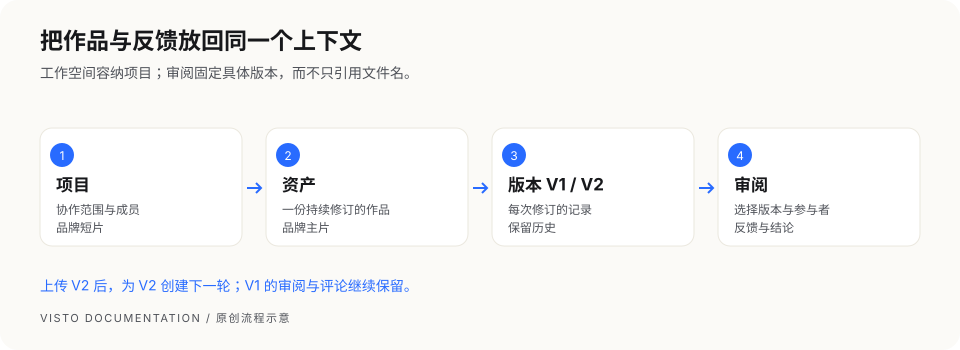

**图解：** 一个项目可以有多个资产；一个资产可以有多个版本；审阅引用选定的版本。上传新版以后，旧审阅仍保留原来审阅的版本，下一轮应明确选择新版。

### 按身份选择阅读路线

| 你的身份 | 先读哪些章节 | 你最需要知道的事 |
| --- | --- | --- |
| 安装维护者 | 安装准备 → 对应平台安装 → 媒体运行时 → 备份恢复 | 主机操作在部署机器执行，需要相应系统权限 |
| Owner | 首次设置 → 存储 → 成员权限 → 网络安全 | 管理全局基础设施，不要把 Owner 密码当团队共享密码 |
| 项目主管 | 创建项目 → 成员权限 → 审阅 → 归档 | 项目成员关系和具体权限决定协作边界 |
| 项目成员 | 上传素材 → 版本 → 审阅 → 通知 | 先进入正确项目，再上传和创建审阅 |
| 外部审阅者 | 外部审阅指南 | 使用分享链接和访问码，按开放权限查看、评论或下载 |

### 适用与限制

本手册介绍 Visto Server 浏览器工作台。支持的安装包和下载开放情况请看[下载与版本说明](downloads.html)。


<!-- chapter: quick-start | 开始使用 -->
## 02 · 做完你的第一个项目

本章面向已经能打开 Visto 的 Owner 或项目主管。建议先用一张不含敏感内容的图片完成练习，再接入真实项目。

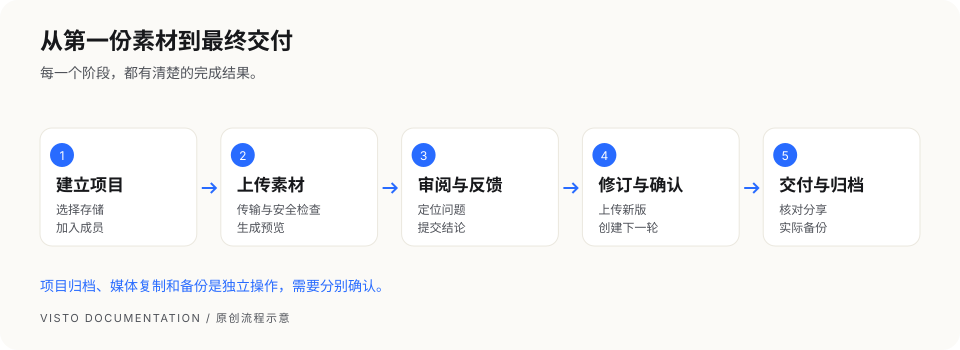

### 第一步：确认保存位置

Owner 进入 **Owner 设置 → 存储与上传安全**，至少创建一个可供项目上传使用的存储位置，并开放给需要的项目。项目主管看不到存储或没有创建权限时，请联系 Owner。

### 第二步：创建项目

在项目列表点“新建项目”，填写名称、项目说明，并选择项目存储位置。建议名称包含作品与交付批次，如“品牌短片 · 10 月交付”；说明写清目标、负责人和交付日期。

### 第三步：上传一份媒体

进入新项目的“媒体”，选择“上传本地文件”。等上传完成，再等媒体状态变成可预览。上传完成只说明传输结束，后台预览处理可能还在继续。

### 第四步：创建第一轮审阅

打开素材详情，确认是 V1，点“创建审阅”。填写审阅名称，选择参与成员、通过条件和截止时间；需要外部反馈时，设置访问密码、评论和下载权限，再创建审阅分享。

### 第五步：收集并处理反馈

用分享入口查看图片或播放视频。提交一条能定位到画面或时间的反馈，项目内核对评论，再回复处理结果。需要正式结论时由具备权限的审阅者提交“通过”“需修改”或“拒绝”。

### 第六步：提交新版

回到原资产的详情，选择“上传新版本”，上传修订文件。确认 V2 出现在版本历史里，以 V2 创建下一轮审阅。不要为了升级版本而把同一作品反复作为独立资产上传。

### 第七步：交付与归档

确认最新版本通过、交付链接权限正确、接收者能访问后，再归档项目。归档保留项目记录并暂停项目内写入；备份还需要由部署维护者单独执行。

### 完成检查

- 项目名称、保存位置和参与成员正确。
- 图片或视频能正常预览；没有未处理的隔离或失败提示。
- 反馈能回到原版本和具体位置。
- V1、V2 的历史都保留，当前版本明确。
- 分享在接收者设备上能打开；下载权限符合交付要求。
- 重要数据已有实际备份，项目归档不能替代备份。


<!-- chapter: navigation | 开始使用 -->
## 03 · 熟悉工作台

工作台围绕项目组织日常任务。进入项目后，首先确认顶部项目名，避免把文件或反馈提交到另一个项目。

### 全局入口与项目入口

| 入口 | 用途 | 谁能使用 |
| --- | --- | --- |
| 项目 | 查看自己可见的项目、切换项目 | 已登录用户，结果由权限决定 |
| Owner 设置 | 账号、网络、存储、通知、系统活动与诊断 | Owner |
| 通知 | 查阅站内通知和相关活动 | 按用户及项目权限 |
| 我的账户 | 个人资料、语言、接收偏好与退出 | 当前用户 |
| 项目概览 | 汇总审阅、未解决反馈、最近版本和失败任务 | 项目可见成员 |
| 项目媒体 | 上传、搜索、预览、版本与回收站 | 按项目权限 |
| 项目审阅 | 创建审阅、看板、详情、结论及分享 | 按项目权限 |
| 项目设置 | 基本资料、成员、存储、活动和生命周期 | 按具体管理权限 |

### 用项目概览判断下一步

“项目脉搏”把当前最值得处理的任务汇总出来。先看失败任务是否影响预览，再看未解决反馈和待处理审阅，最后确认最近版本。计数可能受权限和数据加载影响；读取失败时重新加载，不把空白当作“全部处理完”。

### 页面保存的判断方法

点击保存、上传、复制或测试后，要看页面的完成提示。按钮显示“处理中”表示还没结束；错误信息应在当前操作区域处理。复制失败时，查看可见文本再手动复制，不连续点按钮造成重复审阅或分享。


<!-- chapter: prepare | 安装与初始化 -->
## 04 · 安装 Visto

团队已经部署 Visto 时，在浏览器打开工作空间地址即可。自己建立工作空间时，可以选择两种方式：

- **在线安装（推荐）**：复制一条命令，自动获取对应系统的最新正式版，完成程序和视频组件安装。
- **手动安装**：自行从 GitHub 下载程序包，再按系统指南分步执行命令。适合希望自行选择版本或已经下载好安装包的用户。

| 设备 | 安装指南 | 说明 |
| --- | --- | --- |
| M 系列 Mac | [macOS 安装](install-macos.html) | Apple Silicon；需要管理员密码 |
| Windows 电脑 | [Windows 安装](windows-install.html) | x64；需要管理员权限 |
| Linux 服务器 | [Linux 安装](linux-install.html) | x86_64 / ARM64，使用 systemd |
| 已经使用 Docker | [Docker 部署](docker.html) | 适合熟悉容器的用户 |

下载是否开放见[下载页](downloads.html)。官网安装脚本独立于程序包提供，原始 1.0.3 包也可使用；不需要为了取得安装辅助工具重新下载新版程序。手动方式安装你下载的版本，在线方式每次获取最新正式版。

### 安装前准备

- 留出存放原片、预览和备份的磁盘空间。
- 为媒体选择独立文件夹，不要选择整个主目录或系统目录。
- 已有 Visto 实例时先看[更新与维护](maintenance.html)，不要重新安装覆盖现有数据。

### 安装完成后

打开安装终端显示的地址，按[首次设置](setup.html)创建账号和工作空间。默认地址是 <http://127.0.0.1:8787/>；端口变更时以终端提示为准。Docker 默认使用 <http://127.0.0.1:8080/>。

这里的 `127.0.0.1` 表示当前设备。给同事或客户使用时，请[配置团队访问地址](network.html)。

<!-- chapter: install-macos | 安装与初始化 -->
## 05 · macOS 安装

适用于 **Apple Silicon（M 系列）Mac**。Intel Mac 暂不在支持范围内。准备管理员密码并保持联网，下载开放情况见[下载页](downloads.html)。

### 方式一：在线安装（推荐）

打开“终端”，复制这一行并回车：

```bash
curl -fsSL https://visto.akahxh.top/install.sh -o install-visto.sh && bash install-visto.sh
```

脚本先以当前用户检查 macOS 是否允许程序运行，再请求管理员密码安装。按提示确认视频组件下载。密码输入时不显示字符，这是正常现象。脚本会自动选择最新正式版，下载、检查并安装 Server 和视频组件；无需填写版本或组件名称。

安装结束后，打开终端显示的地址，按[首次设置](setup.html)创建工作空间。默认是 <http://127.0.0.1:8787/>；如果端口已被占用，安装器会询问是否使用其他空闲端口。

### 方式二：手动下载后安装

1. 在[下载页](downloads.html)或 GitHub Releases 取得 **macOS · Apple Silicon** 程序包。
2. 双击压缩包解压，保留原文件夹名称，例如 `Visto-Server_1.0.3_macos-arm64`，不要与旧版本混在一起。
3. 在 Finder 中右键点击解压后的文件夹，选择“服务 → 新建位于文件夹位置的终端窗口”。

先取得安装辅助脚本：

```bash
curl -fsSL https://visto.akahxh.top/install.sh -o install-visto.sh
```

再安装这个文件夹里的版本：

```bash
bash install-visto.sh --source-dir .
```

它使用已经解压的程序，不再下载或切换到其他 Server 版本；视频组件由脚本自动准备。原始 1.0.3 包也使用这两条命令，无需给旧安装器添加新参数。

完成后打开终端显示的地址。**两种方式都已包含视频组件安装，不需要额外执行一段组件安装命令。**

### 如果 macOS 提示无法打开

当前程序没有 Apple 开发者签名与公证。脚本会在安装前检查 `visto-server` 与 `visto-core` 是否能运行，不会替你关闭系统安全检查。

1. 弹窗出现时点击**“完成”**，不要将程序移到废纸篓。
2. 脚本会尝试打开**系统设置 → 隐私与安全性**；没有打开时，手动进入该页面。向下滚动到**“安全性”**，点击终端提示的那个程序的**“仍要打开”**。如果再次出现确认弹窗，点击**“打开”或“允许”**。
3. **保留终端窗口。完成放行后，回到终端按回车，安装就会继续。** 无需复制另一条命令，脚本会重新检查同一份程序。

两个程序可能需要分别放行；按终端提示依次处理即可。此时系统服务还没有开始安装。若没有“仍要打开”按钮，关闭并重新打开“隐私与安全性”；仍没有入口时，将终端错误提供给维护者。

想稍后安装时，在等待提示处输入 `q` 或按 `Control-C`。脚本会保留安装文件，并显示一条下次继续的命令；只有暂停或退出后才需要使用它。不要重复最初的在线下载命令，它会创建另一份安装文件。完成放行后，脚本才会请求管理员密码并继续安装。

### 安装之后

上传一个短视频，确认预览可以播放，再开始正式项目。服务管理、日志和卸载见[更新与维护](maintenance.html#maintenance-macos)。

<!-- chapter: windows-install | 安装与初始化 -->
## 06 · Windows 安装

适用于 **Windows x64**。需要管理员权限。以下步骤用于原生 Server；项目成员使用浏览器即可。

### 方式一：在线安装

在开始菜单搜索 **Windows PowerShell**，选择“以管理员身份运行”。复制这一行并回车：

```powershell
Invoke-WebRequest -UseBasicParsing https://visto.akahxh.top/install.ps1 -OutFile install-visto.ps1 -ErrorAction Stop; powershell -NoProfile -ExecutionPolicy Bypass -File .\install-visto.ps1
```

脚本会获取最新正式版，自动检查安装包并安装至 `C:\Program Files\Visto Server`。按提示确认，等待服务和视频组件就绪。Windows 包自带视频组件，无需额外下载 FFmpeg。

### 方式二：手动下载后安装

从[下载页](downloads.html)取得 **Windows · x64** 安装包。在资源管理器中右键压缩包，选择“全部解压”。把解压后的程序放到固定目录，例如 `C:\Program Files\Visto Server`，不要从 ZIP 内直接运行。

打开程序文件夹，确认里面能看到 `Install-VistoServer.ps1`、`bin` 和 `web`。视频组件已随 Windows 安装包提供，无需另外下载安装。

#### 运行安装

在开始菜单搜索 **Windows PowerShell**，选择“以管理员身份运行”。先进入程序文件夹：

```powershell
Set-Location 'C:\Program Files\Visto Server'
```

如果你选择了其他位置，把文件夹路径改成实际位置。然后运行：

```powershell
powershell -NoProfile -ExecutionPolicy Bypass -File .\Install-VistoServer.ps1
```

安装器会创建开机启动任务。这个命令只为本次运行指定执行策略，不需要修改系统的全局设置。

### 打开 Visto

安装结束后，在这台电脑的浏览器打开 **<http://127.0.0.1:8787/>**，按[首次设置](setup.html)完成配置。若页面暂时打不开，稍等片刻再刷新。

先上传一个短视频，等待生成预览并尝试播放。遇到问题见[排查指南](troubleshooting.html)，服务管理、备份和卸载见[更新与维护](maintenance.html#maintenance-windows)。

<!-- chapter: linux-install | 安装与初始化 -->
## 07 · Linux 安装

适用于 **x86_64 / ARM64 的 systemd Linux 服务器**。要求内核 4.18+、glibc 2.28+、systemd 239+，以及 sudo 权限、Bash、GNU tar 和 curl。下载开放情况见[下载页](downloads.html)。

### 方式一：在线安装（推荐）

在服务器终端复制这一行：

```bash
curl -fsSL https://visto.akahxh.top/install.sh -o install-visto.sh && sudo bash install-visto.sh
```

脚本会识别架构、获取最新正式版并安装程序和视频组件。按终端提示确认下载，等待完成；无需选择组件或填写版本号。

### 方式二：手动下载后安装

1. 从[下载页](downloads.html)或 GitHub Releases 下载对应架构的 Linux 包。普通 Intel / AMD 服务器选 x86_64，ARM 服务器选 ARM64。
2. 保留压缩包原名，把它放到独立安装文件夹；这个文件夹内只保留一个 Visto `.tar.gz` 包。
3. 在该文件夹打开终端，取得辅助脚本：

```bash
curl -fsSL https://visto.akahxh.top/install.sh -o install-visto.sh
```

安装这个已经下载的包：

```bash
sudo bash install-visto.sh --package ./Visto-Server_*.tar.gz
```

脚本会自动解压，使用包名中的版本，并准备视频组件；不会替换成其他 Server 版本。无需手动比对校验值。

### 打开工作空间

使用安装终端最后显示的地址；默认是 <http://127.0.0.1:8787/>。有浏览器的服务器可直接按[首次设置](setup.html)创建工作空间。

远程服务器可通过 SSH 临时打开设置页面。在自己的电脑终端执行，把 `user@server` 换成实际 SSH 登录地址：

```bash
ssh -N -L 18787:127.0.0.1:8787 user@server
```

保持 SSH 连接，在自己的浏览器打开 <http://127.0.0.1:18787/>。如果安装端口变更，也要调整转发命令中的服务器端口。日常协作使用[团队访问地址](network.html)。

服务管理、日志、备份和卸载见[更新与维护](maintenance.html#maintenance-linux)。

<!-- chapter: runtime | 安装与初始化 -->
## 08 · 视频预览与组件安装

Visto 使用 FFmpeg 和 ffprobe 生成封面、预览与媒体信息。

**按 macOS 或 Linux 指南使用官网安装脚本时，视频组件会一起安装。Windows 包已经包含这些组件。完成安装后，无需再运行本页的额外命令。**

程序和组件可以分别更新；安装工具负责选择兼容组件、下载和验证。普通用户无需填写组件版本、签名或校验值。

组件与程序不在同一目录，卸载 Visto 时它不会被一并删除；重装会复用现有组件。需要彻底清理设备时见[第 24 章的删除视频组件](maintenance.html)。

### 旧包缺少视频组件

原始 1.0.3 包也可以使用独立安装脚本。在原始解压文件夹打开终端：

```bash
curl -fsSL https://visto.akahxh.top/install.sh -o install-visto.sh
# macOS：不要用 sudo，脚本会先以当前用户检查程序，通过后才请求安装权限
bash install-visto.sh --source-dir .
# Linux：使用 sudo
sudo bash install-visto.sh --source-dir .
```

同版本 Server 已安装时，脚本会补齐视频组件并重启服务，不覆盖项目数据；安装的是不同版本时会停止，请先看[维护指南](maintenance.html)。

这不会把旧包的网页变成新版网页向导；是否有组件状态提示，以实际程序版本为准。

### 提示 unknown option: --with-media-runtime

原始 1.0.3 安装器不支持这个参数。改用上面的独立安装脚本，不要继续给旧脚本添加它。参数报错本身不会开始安装，无需因此卸载或删除数据。

### 确认视频能正常使用

在测试项目上传一段短视频，等待处理完成后打开媒体详情，确认预览可以播放。

### 页面提示缺少视频组件时

“服务器缺少视频处理组件”表示服务器未找到可用的 FFmpeg 或 ffprobe，不能据此判断视频损坏。原文件仍然保留；组件未修复前重复点重试不能解决问题。

- 工作空间 Owner：从视频详情点“检查视频组件”，或打开 Owner 设置 → 视频组件与编码。
- 普通项目成员：联系服务器管理员或工作空间 Owner；浏览器所在电脑安装 FFmpeg 不会修复远程服务器。
- 首次设置允许先创建工作空间，但缺少组件时封面与视频预览暂不可用。

管理员先在运行 Visto 的服务器上检查已有 FFmpeg/ffprobe。后台可复制与**服务器平台**匹配的本机检查和配置命令；在该实例的安装目录执行，CLI 与服务必须使用相同运行时根。两个程序均存在还不代表编码能力通过，需执行本机 `media-runtime inspect` 能力检查，或在编码设置中查看实际探测结果。

已有组件兼容就复用；自定义路径需要同时包含两个程序。缺失或不兼容时，按本章对应平台安装步骤取得审核版；断网时使用同平台的离线包、清单和配套签名。不得绕过签名与摘要检查。Windows 正式包自带组件，缺失时先核对解压完整性与服务启动入口；开发预览包可能不包含组件。Docker 应使用含组件的配套镜像，不能套用原生主机安装命令。

配置后重启**同一个 Visto 实例**，回到后台点“重新检查”。通过后可点“重试最近受影响任务”；该入口只重新排队最近 200 个失败任务中明确因缺少组件失败的媒体任务，逐项显示成功数与失败数。更早的任务在项目媒体详情中重试。页面也会保留磁盘、格式或编码错误等其他原因的失败，避免误重试无关任务。

缺少组件的新任务会在第一次失败后停止自动重试，页面显示等待配置；恢复后仍由用户主动重试。已有可播放预览继续可用，后台增强失败不会移除预览。

### 失败时怎么处理

| 现象 | 怎样处理 |
| --- | --- |
| 下载失败 | 检查网络后重试，保留具体错误信息 |
| 验证失败 | 停止安装，将错误信息提供给维护者 |
| macOS 阻止程序运行 | 按 [Mac 安装说明](install-macos.html)允许对应程序，然后重试 |
| 安装完成但没有预览 | 检查媒体处理错误与磁盘空间 |
| 只有某个视频无法处理 | 先用另一段短视频测试，再检查原文件格式 |

<!-- chapter: docker | 安装与初始化 -->
## 09 · Docker 部署说明

### 从 Docker Hub 直接安装（推荐）

Visto Server 1.0.3 已在 Docker Hub 提供 [Core 镜像](https://hub.docker.com/r/akahxh404/visto-core)和 [Web 镜像](https://hub.docker.com/r/akahxh404/visto-web)，同时支持 Linux amd64 与 arm64。Docker 会自动选择主机架构；Windows Docker Desktop 使用 Linux 容器模式。这两个镜像需要配合 Compose 使用，浏览器连接 Web，Core 端口只在容器网络内开放。

1. 下载官网提供的 [Visto Docker 1.0.3 部署包](https://visto.akahxh.top/downloads/docker/1.0.3/Visto-Docker_1.0.3.zip)，解压到一个新的部署目录。包内包含固定镜像的 `compose.yaml`、版本清单和 `scripts/docker/` 备份、恢复、更新工具；不需要下载完整源码。
2. 启动 Docker Desktop 并等待 Engine 运行，或启动主机的 Docker Engine。在解压目录打开终端，先确认 `docker version` 和 `docker compose version` 能正常返回；只安装客户端但未启动 Engine 时不能部署。
3. 在仅维护者可读的目录中生成初始化令牌，并拉取镜像。Windows 原生 PowerShell 使用下面的命令；已有 `.env` 时会停止，不覆盖已有配置。

```powershell
$ErrorActionPreference = 'Stop'
$rng = [System.Security.Cryptography.RandomNumberGenerator]::Create()
try {
  $bytes = New-Object byte[] 32
  $rng.GetBytes($bytes)
  $token = [Convert]::ToBase64String($bytes)
  $stream = [System.IO.File]::Open((Join-Path $PWD '.env'), [System.IO.FileMode]::CreateNew)
  try {
    $content = [System.Text.Encoding]::ASCII.GetBytes("VISTO_VERSION=1.0.3`nVISTO_HOST_MANAGEMENT_TOKEN=$token`n")
    $stream.Write($content, 0, $content.Length)
  } finally { $stream.Dispose() }
} finally { $rng.Dispose() }
docker compose pull
if ($LASTEXITCODE -ne 0) { throw '镜像下载失败，请检查 Docker 和网络后重试' }
docker compose up -d --no-build --wait
if ($LASTEXITCODE -ne 0) { throw 'Docker 启动失败，请先处理报错' }
docker compose ps
```

macOS / Linux / Windows WSL 的 Bash 终端使用：

```bash
(
set -eu
umask 077
set -C
printf 'VISTO_VERSION=1.0.3\nVISTO_HOST_MANAGEMENT_TOKEN=%s\n' "$(openssl rand -base64 32)" > .env
docker compose pull
docker compose up -d --no-build --wait
docker compose ps
)
```

4. 打开 <http://127.0.0.1:8080/>，从你自己保存的 `.env` 私下读取完整初始化令牌，按[首次设置](setup.html)创建工作空间和账号。后续启动保留同一份 `.env`，不要重复生成令牌，也不要公开该文件。

如果 8080 端口已被其他服务占用，在首次启动前给 `.env` 增加一行 `VISTO_HOST_PORT=18080`，然后使用 <http://127.0.0.1:18080/>；不要停掉不属于 Visto 的服务。需要 Docker Engine 26+ 和 Compose v2，可用磁盘空间应覆盖媒体、预览及备份。

部署包已固定两个镜像的不可变摘要，无需手工选择或填写摘要。视频组件已经包含在 Core 镜像中，无需单独安装。首装仍需要联网拉取镜像；如果拉取超时，先检查 Docker 的网络和代理配置，再重试 `docker compose pull`。

### 从完整源码构建（可选）

下面仅适用于选择完整源码交付的维护者，不用于上述小型部署包。

本章供已有 Docker 经验的维护者使用。公共源码交付包含 `Dockerfile`、`.dockerignore`、`compose.yaml`、`infra/docker/nginx.conf`、固定视频组件索引及 `scripts/docker/` 维护工具。下载同一次交付的完整源码目录，在该目录运行命令；平台验收范围以发布清单为准。首次源码构建需要联网下载固定基础镜像、程序依赖与验过摘要的视频组件。

### 前置条件与结构

需要 Docker Engine 26+、Docker Compose v2、至少 4 GB 可用内存、足够持久卷空间和可用的本机端口。官方 Compose 分为 `core` 与 `web`：浏览器连接 Web，Web 代理 Core；Core 的 8787 端口不应直接暴露给宿主机。

在提供 `compose.yaml` 的部署目录里生成并保存首次初始化令牌。以下 Bash 命令在 macOS/Linux 终端或 Windows WSL 中运行；Windows 原生 PowerShell 请使用后面的专用命令。已有 `.env` 时停止，不覆盖原配置：

```bash
# 使用交付说明给出的实际程序版本；示例为已发布的 1.0.3。
(
set -eu
# noclobber 阻止覆盖已有文件；umask 限制令牌文件读取权限。
umask 077
set -C
printf 'VISTO_VERSION=1.0.3\nVISTO_HOST_MANAGEMENT_TOKEN=%s\n' "$(openssl rand -base64 32)" > .env
docker compose up -d --build
docker compose ps
)
```

本机浏览器打开 `http://127.0.0.1:8080/`，从本机 `.env` 读取令牌并完成首次设置。Compose 后续会自动读取同目录 `.env`，不要重新生成令牌；不要提交该文件到仓库或发给成员。Bash 维护脚本在新终端运行前，先在部署目录执行 `set -a; . ./.env; set +a`，只载入你自己维护的可信配置。记录当前部署目录、Compose 配置、固定镜像与数据卷信息，以便维护时使用。

Windows 原生 PowerShell 首次启动示例（在仅维护者可读的部署目录执行；已有 `.env` 不覆盖）：

```powershell
$ErrorActionPreference = 'Stop'
$rng = [System.Security.Cryptography.RandomNumberGenerator]::Create()
try {
  $bytes = New-Object byte[] 32
  $rng.GetBytes($bytes)
  $token = [Convert]::ToBase64String($bytes)
  $stream = [System.IO.File]::Open((Join-Path $PWD '.env'), [System.IO.FileMode]::CreateNew)
  try {
    $content = [System.Text.Encoding]::ASCII.GetBytes("VISTO_VERSION=1.0.3`nVISTO_HOST_MANAGEMENT_TOKEN=$token`n")
    $stream.Write($content, 0, $content.Length)
  } finally { $stream.Dispose() }
} finally { $rng.Dispose() }
docker compose up -d --build
if ($LASTEXITCODE -ne 0) { throw 'Docker 构建或启动失败，请先处理报错' }
docker compose ps
```

PowerShell 维护脚本从环境变量取得令牌；新终端在同一部署目录执行下面的命令。仅读取自己保存的可信 `.env`，不要把令牌贴入聊天或公开日志：

```powershell
$tokenLines = @(Get-Content -LiteralPath .env | Where-Object { $_ -match '^VISTO_HOST_MANAGEMENT_TOKEN=' })
if ($tokenLines.Count -ne 1) { throw '.env 必须包含唯一的初始化令牌，请检查配置' }
$env:VISTO_HOST_MANAGEMENT_TOKEN = $tokenLines[0].Substring('VISTO_HOST_MANAGEMENT_TOKEN='.Length)
```

### 使用随交付提供的视频组件归档构建

若交付包含视频组件归档，可在源码目录旁建立 `runtime-input` 目录，放入本机架构对应的原文件：

- x86_64：`Visto-Media-Runtime_ffmpeg-8.1.2-linux-amd64-lgpl.2_linux-amd64.tar.xz`
- ARM64：`Visto-Media-Runtime_ffmpeg-8.1.2-linux-arm64-lgpl.2_linux-arm64.tar.xz`

使用支持命名构建上下文的 Docker Buildx，在完整源码目录执行：

```bash
(
set -eu
# 先载入当前部署版本；以下步骤在 Bash / WSL 执行。
set -a; . ./.env; set +a
case "$(uname -m)" in
  arm64|aarch64) PLATFORM=linux/arm64 ;;
  x86_64) PLATFORM=linux/amd64 ;;
  *) echo '不支持的架构'; exit 1 ;;
esac
docker buildx build --load --platform "$PLATFORM" \
  --build-context runtime-input=../runtime-input \
  --build-arg VISTO_VERSION="$VISTO_VERSION" \
  --target core -t visto-core:local .
docker buildx build --load --platform "$PLATFORM" \
  --build-arg VISTO_VERSION="$VISTO_VERSION" \
  --target web -t visto-web:local .
docker compose up -d --no-build
)
```

此示例使用 Compose 默认的 `visto-core:local` 与 `visto-web:local` 名称；仅对初次部署使用，不覆盖正在运行的已有版本镜像来代替受保护更新。若 `.env` 已指定其他镜像，先核对配置，不套用默认名称。构建结束后记录实际镜像 ID 和源码版本。

这只避免重新下载视频归档；基础镜像和程序依赖仍需联网或已在本机缓存。构建器始终按源码内固定记录自动校验组件，摘要不符立即失败。归档文件缺失时仍走原 HTTPS 下载流程。交付同时提供组件对应源码、第三方声明和许可证；镜像保留组件及静态 GCC 运行时的许可证与来源记录。发布清单尚未确认可取得的文件，不算已完成公开交付。

### 日常命令

```bash
docker compose ps
docker compose logs --tail 100 core
docker compose exec core visto-server doctor
docker compose down
```

`down` 用于停止这套部署。**不要添加 `-v`**，否则可能删除持久业务数据卷。项目数据、加密秘密和默认托管媒体位于数据卷；额外挂载和远程存储还要独立备份。

### 备份与恢复

在同一部署目录，由维护者运行交付中的脚本：

```bash
./scripts/docker/backup-visto-docker.sh --backup-dir ./backups
```

恢复会替换当前卷，先核对备份与同名 JSON 元数据、校验文件、目标部署及异盘副本，再执行：

```bash
./scripts/docker/restore-visto-docker.sh \
  --backup-file './backups/<实际备份文件>.tar.gz' \
  --confirm-restore
```

这些 Docker 脚本的选项与 macOS 原生脚本不同，不混用原生安装路径。Docker 恢复也支持 `--check-only` 做预检；执行前先用脚本的 `--help` 核对参数。Docker Hub 1.0.3 的固定镜像引用已记录在部署包的 `docker-images.json` 中。后续升级仍使用交付内的受保护更新脚本及该版本公布的固定 `image@sha256:` 引用，保留更新前备份和失败恢复；不要用可变 `latest` 标签或简单重建容器代替已有部署的升级流程。更新失败时先保留错误和备份，再按排查指南处理。


<!-- chapter: setup | 安装与初始化 -->
## 10 · 首次设置与登录

首次打开一个尚未初始化的实例，会看到“先建立你的本地工作空间”。这个过程创建数据库中的工作空间和 Owner，不会替你移动已有媒体。

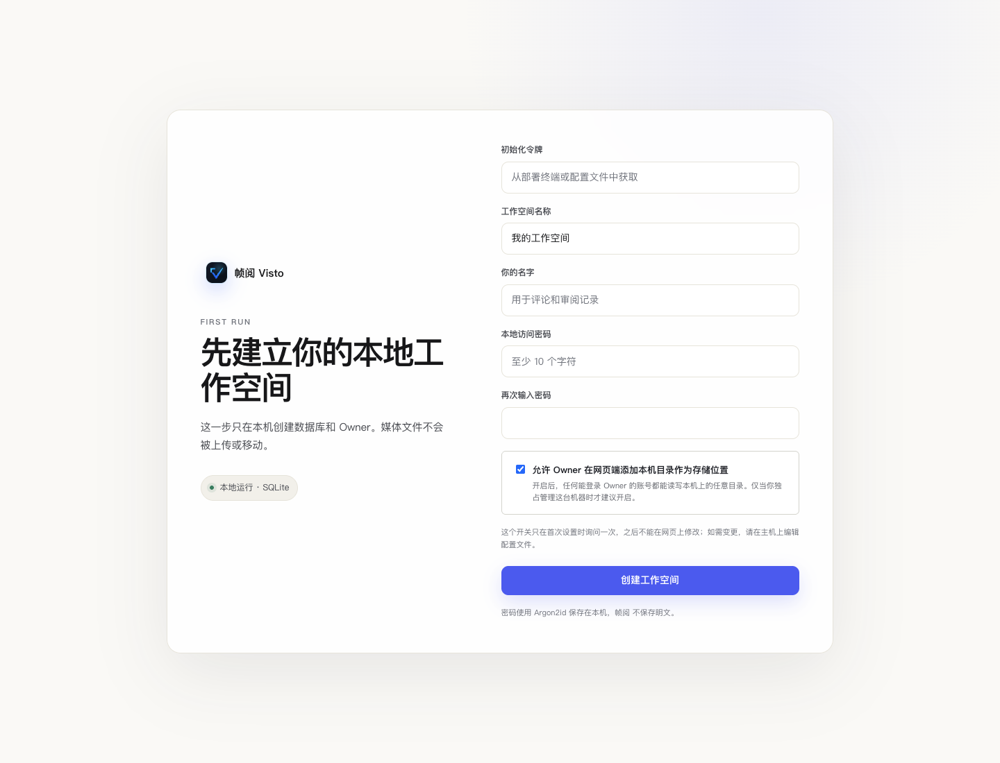

**看图操作：** 先核对初始化令牌，再填写身份信息；最下方的主机目录权限影响后续存储配置，提交前决定好。

### 填写首次设置

| 字段 | 如何填写 | 说明 |
| --- | --- | --- |
| 初始化令牌 | 由部署维护者在主机取得 | 原生 macOS 从配置目录读取；Docker 使用启动时生成的值 |
| 工作空间名称 | 如“视频制作团队” | 会出现在工作台，名称应让成员容易辨认 |
| 你的名字 | 如“项目负责人”或真实姓名 | 用于评论和审阅记录，不是共享身份 |
| 本地访问密码 | 至少 10 个字符的强密码 | 不与其他网站复用 |
| 再次输入密码 | 与上面完全一致 | 输入不一致时不能提交 |

macOS 读取初始化令牌：

```bash
sudo cat /Library/Visto/config/host-management-token
```

Linux 默认安装：

```bash
sudo cat /etc/visto/host-management-token
```

Windows 默认安装，在管理员 PowerShell 中读取：

```powershell
Get-Content -LiteralPath "$env:ProgramData\Visto\data\host-management-token.txt"
```

默认路径中的 `data` 不能省略。自定义数据目录时，使用安装器显示的实际令牌位置。
“找不到路径”时先核对文件位置和安装是否成功；“拒绝访问”时重新以管理员身份打开 PowerShell，
不要放宽文件权限。安装器显示的短指纹不能代替完整令牌。

令牌用于首次领取初始化权限，和日常登录密码不同。不要把该输出贴到聊天、截图或公开 Issue。

### 一次性的主机目录权限

“允许 Owner 在网页端添加本机目录作为存储位置”默认开启。开启后，Owner 网页会话能配置主机目录，适合由你独占管理的机器；不信任所有 Owner 登录环境或部署在共享主机时，应由维护者评估后选择关闭。

该选项**首次设置后不能在网页上更改**。需要调整时由主机维护者编辑 `visto.env` 的 `VISTO_ALLOW_WEB_HOST_PATHS`：`0` 关闭，`1` 强制开启，然后重启服务。当前生效状态可在 **Owner 设置 → 网络与安全** 查看。

关闭后普通网页不能添加本机路径。项目成员仍可使用已经授权给项目的存储；如果必须添加新的主机目录，请联系部署维护者，不要求成员知道服务器真实路径，也不把 Desktop 当作免费版前置条件。

### 日常登录

初始化完成后，日常使用成员邮箱和密码进入。旧工作空间 / 首次 Owner 可能尚未设置登录邮箱，登录页提示允许邮箱留空时可使用原访问密码。登录后在“我的账户”确认个人身份与可用资料；新增成员使用独立邀请或注册流程。

### 完成检查与问题处理

- 成功后进入项目列表，而不是仍停留在创建表单。
- 密码错误、令牌错误和创建失败会显示提示，先按提示修正，不重复初始化。
- 已有实例突然出现首次设置页时，先核对浏览器地址和数据目录是否指向原实例。不要立即创建一个新工作空间覆盖问题。
- 忘记 Owner 密码时联系主机维护者，通过当前版本支持的账号恢复方式处理，不删除数据库重新初始化。


<!-- chapter: storage | 项目与素材 -->
## 11 · 配置文件保存位置

**谁来操作：** Owner。**入口：** Owner 设置 → 存储与上传安全。

Visto 需要先有可用且已开放的存储，项目才能选择上传落点。浏览器所在电脑的路径不等于服务器路径：主机目录始终指向运行 Visto 的电脑或容器可见目录。

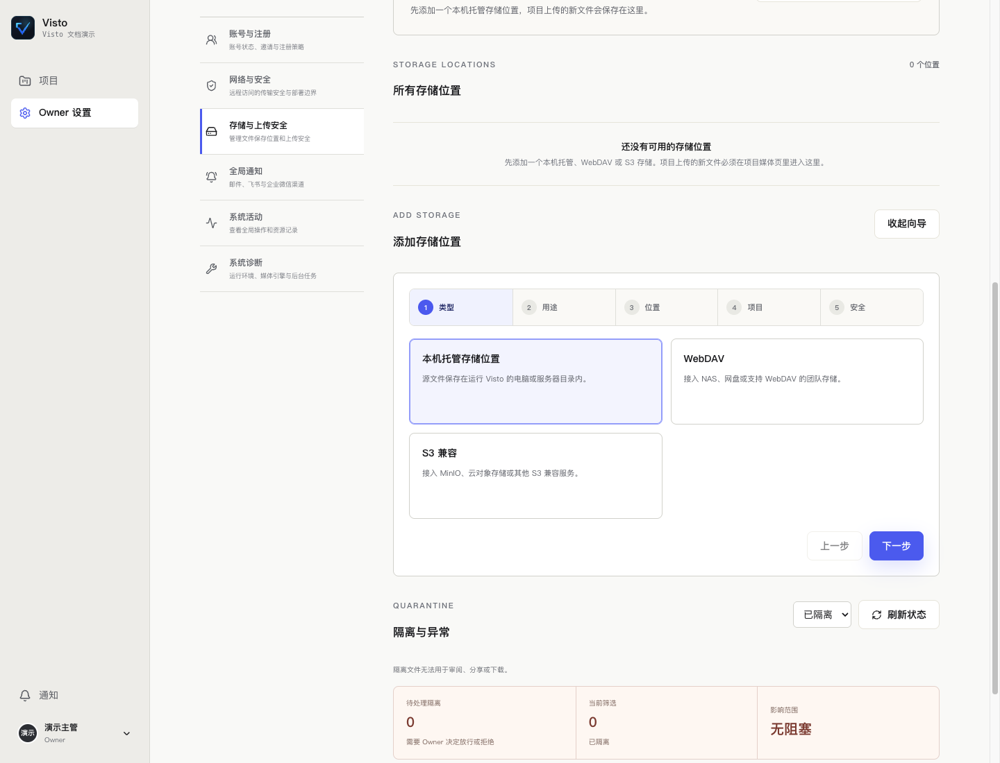

**看图操作：** 上方查看现有保存位置和异常，下面的向导按“类型 → 用途 → 位置 → 项目 → 安全”依次完成。

### 三种存储选择

| 类型 | 要准备的信息 | 常见场景 |
| --- | --- | --- |
| 本机托管存储 | 主机上的专用绝对目录、可写权限、空间 | 单机制作、连接在部署主机上的磁盘 |
| WebDAV | 服务地址、用户名、密码、允许的目录 | 支持 WebDAV 的 NAS 或存储服务 |
| S3 兼容 | Endpoint、Bucket、Region 及访问密钥等页面字段 | MinIO 或对象存储 |

使用最小必要权限的账号。远程连接先按页面测试连通性；网络策略可能拒绝某些地址，不能把地址填成可访问任意主机的代理。

### 本机存储：路径、权限和配额

名称用于让项目成员辨认，如“制作素材盘”；主机目录使用运行 Visto 的机器上的绝对路径。建议由维护者先建一个专用目录，给服务运行账号所需权限，再在向导填写；不要为了修复写入错误让所有人拥有整块磁盘的任意权限。

外接盘使用前确认它已挂载，盘名和路径稳定。Docker 中填写的是容器可见路径，宿主机目录需要由维护者正确挂载。容量配额留空时按页面含义不限制，并不意味着磁盘无限大。关注存储剩余空间，预览与备份也需要容量。

### WebDAV：每个字段怎么填

| 字段 | 示例（虚构） | 填写要点 |
| --- | --- | --- |
| 连接名称 | 团队 NAS · 制作资料 | 让项目主管能识别，不写密码 |
| 连接地址 | `https://nas.example.com/dav` | 使用服务提供的 WebDAV Endpoint，不填普通登录页 |
| 用户名 / 密码 | 独立的媒体服务账号 | 需有目标目录的读取及所需写入权限 |
| 默认路径前缀 | `team-media` 或留空 | 限定这条连接使用的范围，和服务器路径结构一致 |
| 允许连接局域网或内网地址 | 仅在需要接入可信 NAS 时启用 | 只授权你明确知道的内部存储服务 |

创建连接后按界面测试。连接通了但项目上传仍不可用时，继续检查根目录范围、项目开放和用途。修改既有凭据时读清页面“留空保留”说明，不误把密码清空。

### S3 兼容：Endpoint、Bucket 与前缀

| 字段 | 示例（虚构） | 填写要点 |
| --- | --- | --- |
| 连接地址 | `https://s3.example.com` | 使用存储商提供的 API Endpoint，不用控制台网页地址 |
| Access Key / Secret Key | 专用访问密钥 | 不截图、不写入项目说明，不用个人最高权限密钥 |
| 区域 | 存储商要求的 Region | 以服务实际配置为准，不复制其他供应商的值 |
| 桶名称 | `team-media` | 必须是已存在且该密钥有权访问的 Bucket |
| 默认路径前缀 | `visto/brand-film` | 限定对象范围，和实际组织约定一致 |

Endpoint、区域、桶与密钥要属于同一服务。测试失败时区分连通性、认证和对象权限，不连续换填猜测值。上述域名和桶名只用于解释字段，不能直接用作可连接的存储。

### 完成五步向导

1. **类型：** 选择本机、WebDAV 或 S3。
2. **用途：** 日常上传选“作为项目上传位置”；交付保存选“作为归档位置”；评论附件选对应用途。归档位置不会自动成为默认上传位置。
3. **位置：** 填可辨认的名称和相应连接信息。主机目录权限关闭时，本机路径不能在普通网页添加。
4. **项目：** 选择开放范围。保存一个连接不代表所有项目都获得使用权限。
5. **安全：** 选择上传安全策略并提交，查看成功或错误提示。

### 上传安全策略

| 策略 | 适合的使用情景 | 需要理解的边界 |
| --- | --- | --- |
| 快速 | 可信素材和受控内部协作 | 保留路径、权限、大小等基础检查；恶意软件扫描可能记为未扫描 |
| 标准 | 日常默认项目上传 | 基础检查和媒体探测后处理；扫描结果继续影响分享与下载 |
| 增强 | 公网、访客或不可信来源素材 | 检查通过前不应进入可分享、可下载、可审阅状态；还要配置实际扫描能力 |

策略名称不代表扫描引擎已经配置。查看具体检查结果，“未扫描”不能当作“安全扫描通过”。

### 让项目真正能用

创建后检查存储显示“可用”，用途是上传，开放范围包括当前项目。进入 **项目设置 → 项目存储** 确认上传位置。若下拉框为空，依次检查：是否有活动存储、是否允许上传、是否对项目开放、是否因配额或错误停用。

### 修改、停用和删除

修改存储前先查看受影响项目。停用可能阻止后续上传；删除连接和删除原文件不是一回事，按影响说明处理。不要从操作系统直接挪走正在使用的目录；已有媒体引用可能失效。新增归档位置也不会自动把全部媒体复制过去。

**完成检查：** 项目能选到位置，上传小文件成功，预览可读，空间与权限符合预期。


<!-- chapter: project | 项目与素材 -->
## 12 · 创建与管理项目

项目是协作范围。把不同客户、交付批次或权限边界放进不同项目，可以减少误共享和误操作。

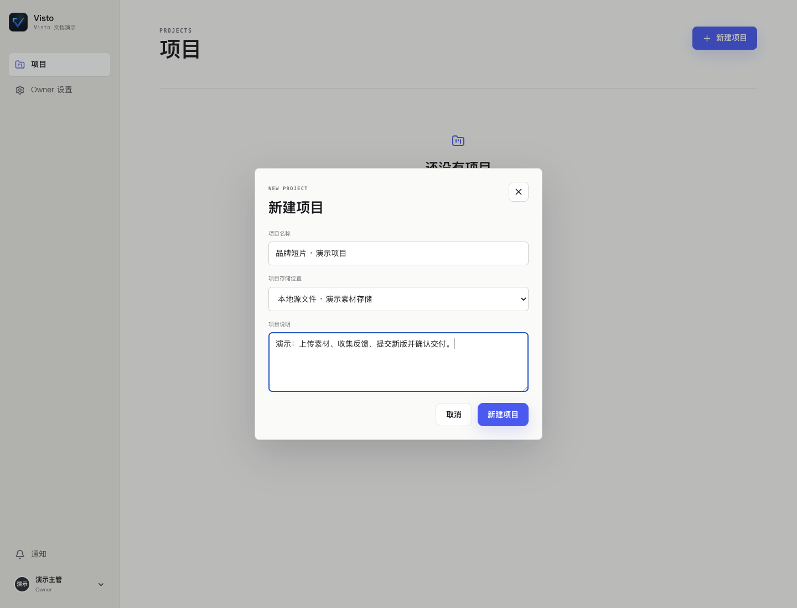

### 创建项目

1. 回到项目列表，点“新建项目”。
2. 填写名称；建议“作品 / 客户 + 批次”，避免多个“新项目”。
3. 选择已开放的“项目存储位置”。没有位置可选时让 Owner 配置，不去寻找扫描导入入口。
4. 在说明里写目标、交付内容、负责人员和时间。
5. 提交并确认进入正确项目。

示例说明：“60 秒品牌短片；主片横版 16:9，社交裁切另立资产；导演先看节奏，客户确认文案；交付日前完成最终审阅。”

### 项目主管的日常维护

在项目设置维护基本资料和成员；存储只选择 Owner 已授权的范围。更换上传位置主要决定后续落点，不应默认理解为已有媒体已迁移。需要转移主管职责时使用项目提供的转移流程，检查新的主管和自己的保留角色，再确认。

### 成员看不到项目时

先检查是否登录正确工作空间和账号，再检查项目成员关系、账号状态和期限。用户已经注册或已经在团队里，不代表已被加入该项目。失去成员资格、项目删除或权限不足都可能使项目不可见。

**完成检查：** 名称和说明正确、上传存储可用、成员在各自账号中可见应参与的项目。


<!-- chapter: members | 项目与素材 -->
## 13 · 成员、邀请与权限

Visto 有工作空间账号与项目成员两层关系。团队邀请让一个人拥有自己的账号；项目成员关系决定他能在哪个项目里工作。

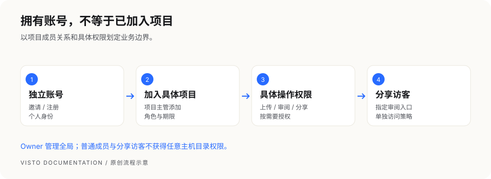

### 常见身份

| 身份 | 作用 | 权限原则 |
| --- | --- | --- |
| Owner | 管理全局基础设施和账号 | 有广泛权限，只交给可信维护者 |
| 项目主管 | 管理被分配项目的成员和协作 | 不等于获得其他项目或主机权限 |
| 项目成员 | 参与被加入项目的素材与审阅 | 具体上传、移除、分享和结论权限看成员设置 |
| 临时账户 | 有限项目访问或临时协作 | 检查权限和到期时间；默认权限可较少 |
| 分享访客 | 从指定分享入口查看内容 | 由分享范围、密码、有效期、评论及下载开关约束 |

项目成员默认可有较多协作权限，包括上传、审阅、分享或从项目移除媒体；若某人只需观看，应明确收紧权限，不凭角色名称推断“只读”。

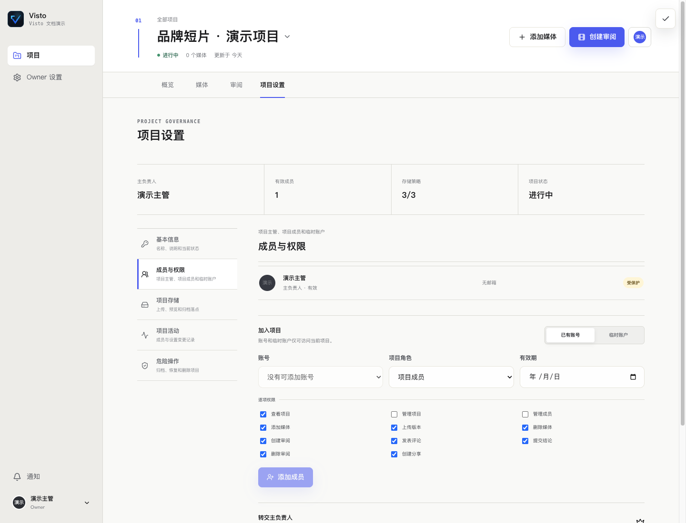

**看图操作：** 在项目设置里管理成员；工作空间账号与本项目的角色分别确认。

### 邀请并加入项目

1. Owner 在 **Owner 设置 → 账号与注册** 创建成员邀请，填写成员邮箱并选择合适的账户类型。
2. 将本次邀请入口交给对应成员；邀请链接和账号不要多人共用。
3. 成员打开邀请页，按页面完成自己的资料和密码设置。
4. Owner 或具备权限的项目主管进入 **项目设置 → 成员与权限**，将该账号加入项目。
5. 选择项目角色及具体权限；有时间边界时设有效期。
6. 用成员自己的账号确认能看见项目、能做被允许的操作。

### 开放注册

Owner 可以配置注册策略。允许注册并不自动给新用户任何项目权限；项目主管或 Owner 仍需把用户加入具体项目。

### 调整或收回访问

成员离开项目时，检查项目成员关系、临时账户期限、已创建的分享和后续通知。移除成员不能收回已被对方下载的文件；外部分享也需要单独检查和撤销。


<!-- chapter: upload | 项目与素材 -->
## 14 · 上传、搜索与整理素材

**谁来操作：** 有相应项目上传权限的成员。**入口：** 进入具体项目 → 媒体。

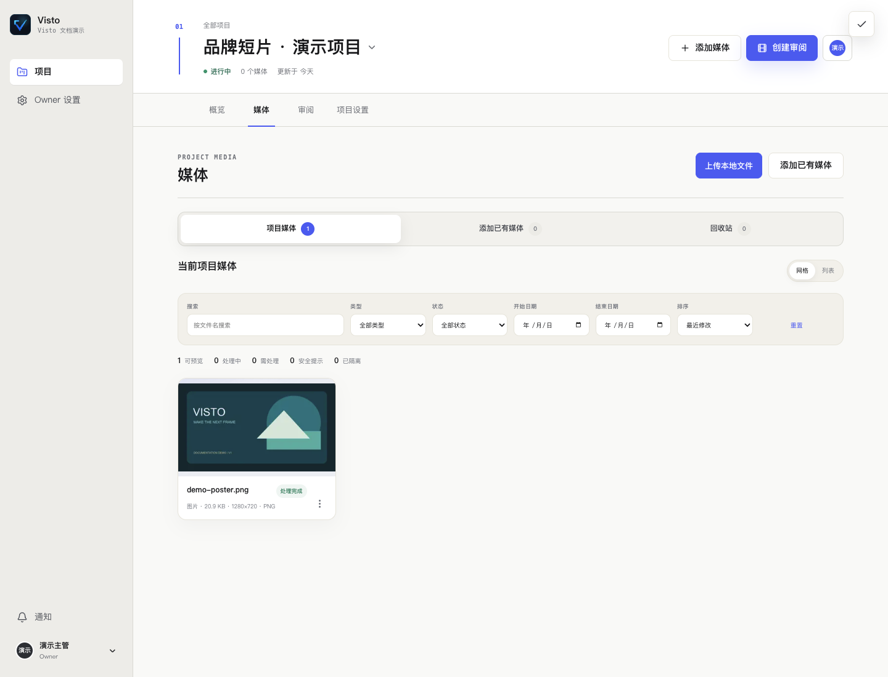

### 上传一个或多个文件

1. 确认顶部项目名。
2. 选择“上传本地文件”，从自己电脑选图片或视频。
3. 在上传任务面板查看等待、传输进度、完成或失败。
4. 失败时先看原因，按需要重新上传；未完成前不要关闭浏览器。
5. 传输完成后等待后台媒体识别与预览处理，再打开素材验证。

浏览器上传把选中的文件复制到项目授权的存储。已存在于服务器的文件不会仅因打开页面而被扫描导入；日常上传应始终在项目内完成。

### 分清三类状态

| 状态层 | 表示什么 | 你应该做什么 |
| --- | --- | --- |
| 上传进度 | 文件是否传完 | 等待完成或修复传输问题 |
| 上传安全检查 | 文件是否可继续参与协作 | 处理隔离、拒绝或扫描提示 |
| 媒体处理 | 预览、识别及增强任务是否完成 | 等处理结束，失败时查看任务详情 |

“上传完成”与“可预览”是不同阶段。源文件在库中但预览失败时，不要先删除重传，先检查运行时和具体任务。

### 搜索和筛选

按文件名搜索，再用类型、处理状态、开始 / 结束日期和排序缩小范围。找不到刚上传文件时，先点“重置”，确认当前项目、页码和筛选条件，再检查上传结果。

网格适合看画面，列表适合看文件信息。打开素材详情可以重命名、查看预览、元信息和版本历史。

### 加入已有媒体、复制和剪切

“添加已有媒体”只展示你有权使用的已有媒体，不是任意主机扫描入口。将资产加入另一个项目前，检查目标项目权限和存储要求。

详情中的“复制 / 剪切”是跨项目操作；不要把它等同于已经在另一个物理磁盘复制了完整文件。按页面结果检查目标项目可见性和媒体可读性。“从当前项目移除”进入项目回收站，恢复步骤见“归档与删除”。

### 命名约定建议

同一作品使用一个资产名称，如“品牌短片主片”；版本保留 V1、V2 的编号。横版、竖版或语言版本若分别交付，可以用不同资产，避免仅靠“最终版 / 最终版2 / 真最终版”区分。


<!-- chapter: archive | 项目与素材 -->
## 15 · 回收站、归档与删除

这些操作的影响不同。执行前先确认你要解决的是“从当前项目移除素材”“停止协作”还是“彻底删除项目”。

| 操作 | 作用 | 能否代替备份 |
| --- | --- | --- |
| 从当前项目移除媒体 | 从当前项目关系中移除，可在项目回收站恢复 | 不能 |
| 恢复回收站媒体 | 把被移除的媒体重新加入当前项目 | 不能 |
| 归档项目 | 保留项目数据，暂停项目内写入和存储调整 | 不能 |
| 恢复项目 | 把已归档项目恢复为进行中 | 不能 |
| 删除项目 | 按确认说明处理项目，可能不可恢复 | 必须先有独立备份 |

### 恢复误移除媒体

进入项目“媒体 → 回收站”，找到相应媒体，使用恢复操作并查看提示。回到项目媒体确认文件和版本可读。若底层原文件已经被外部删除，恢复项目关系不会凭空恢复文件。

### 项目交付后的归档

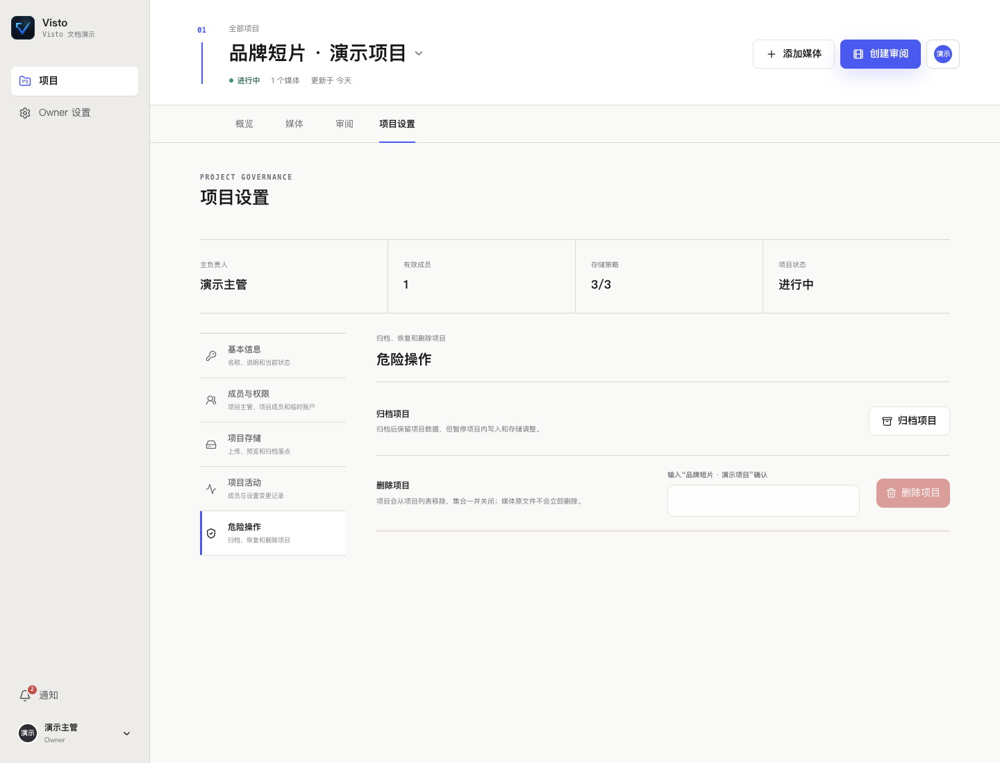

1. 确认最终版本、正式结论和交付内容。
2. 检查未解决反馈，记录保留原因。
3. 检查外部分享，需要停止访问的先撤销。
4. 确认实际备份和必要的媒体异盘副本。
5. 进入 **项目设置 → 危险操作**，选择归档并确认。

归档不会自动把素材复制到归档存储，不会自动做异地备份，也不应假定已经撤销所有分享。需要再次修改时先恢复项目，再重新审阅新版本。

### 删除前必须确认的内容

读清页面对删除范围和可恢复性的提示，核对项目名、版本、分享及备份。不能用项目回收站替代整库恢复。备份恢复通常会影响整个实例，不只是一个项目，请让维护者评估后处理。


<!-- chapter: versions | 审阅与交付 -->
## 16 · 版本管理与新一轮修订

版本历史让你保留原始审阅上下文。修订同一作品时，从原资产的“上传新版本”进入，而不是把修订文件上传成另一个没有关联的资产。

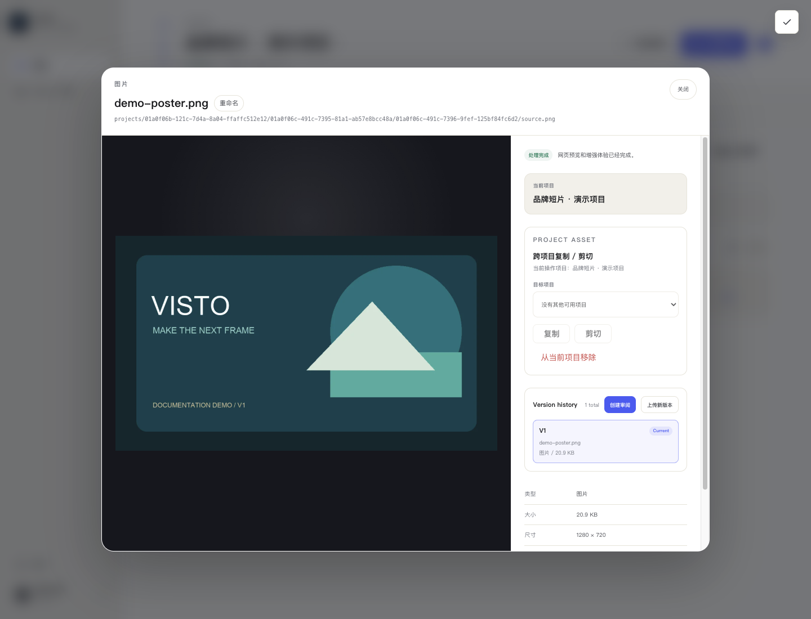

### 上传新版

1. 进入项目媒体，打开原资产详情。
2. 在 `Version history` 区域选择“上传新版本”。
3. 选修订文件，等待上传和处理完成。
4. 确认历史出现 V2 / 下一版本，检查画面和文件信息。
5. 核对 `Current` 标记；需要调整时使用页面支持的当前版本切换操作。
6. 明确选择新版本，再点“创建审阅”开始下一轮。

选择某一历史版本用于预览，与把它设为资产当前版本是两种操作。仅点开 V1 看画面，不应默认认为当前版本已切换到 V1。

### 旧评论会怎样

旧审阅与其评论仍属于原先引用的版本。把 V2 上传到资产并不自动把 V1 的审阅换成 V2。客户从旧链接看到旧版时，先检查分享对应的审阅清单；为新版建立新审阅并发送正确链接。

### 修订说明怎么写

可以在审阅名称和评论中注明改动范围：“V2：调整 00:12–00:18 节奏，修改片尾文案，其他镜头保持。”接收者容易确认改动，你也能追踪哪条反馈已落实。

**完成检查：** 版本编号正确、预览正确、当前版本明确、下一轮审阅确实引用新版。


<!-- chapter: reviews | 审阅与交付 -->
## 17 · 创建一轮审阅

**谁来操作：** 有创建审阅权限的项目成员。审阅是一轮明确的确认任务，围绕指定版本组织参与者、截止时间和判断规则。

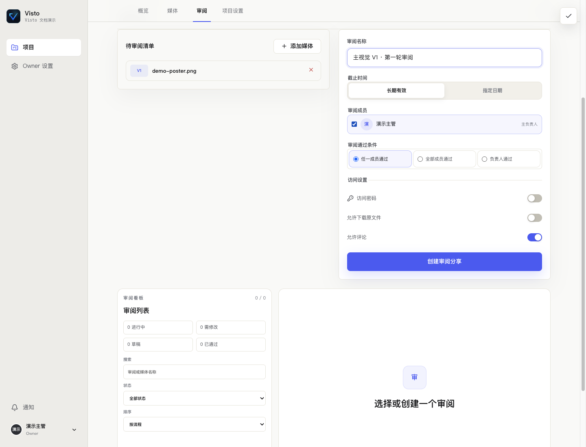

### 创建步骤

1. 从素材详情选定版本后点“创建审阅”；也可在项目“审阅”里选择媒体加入清单。
2. 核对每份作品和 V 编号，移除无关内容。
3. 输入审阅名称，例如“主片 V2 · 客户文案确认”。
4. 设置截止时间；长期有效不代表永远开放写入，仍受审阅状态与分享策略影响。
5. 选择审阅成员和需要的负责人。
6. 选择通过条件。
7. 需要外部分享时设置访问密码、下载和评论权限，提交后核对创建反馈。

### 选择通过条件

| 条件 | 适用情景 | 需要确认 |
| --- | --- | --- |
| 任一审阅者 | 任何一个指定审阅者即可完成确认 | 不适合要求所有部门签字的流程 |
| 所有审阅者 | 每个被要求的审阅者都要确认 | 确保参与者正确，否则可能一直等待 |
| 仅负责人 | 明确由一个负责人做最终判断 | 必须选定负责人，其他评论不替代其结论 |

### 草稿与开启

没有分享权限时，创建结果可能保存为草稿。草稿不等于已经对外发送；先检查审阅状态，按页面开启后再创建分享。创建成功但复制链接失败时，审阅可能已经存在，在详情里继续创建或复制分享，不重新发起相同审阅。

### 看板与详情

项目审阅看板展示不同状态的审阅。打开详情查看固定版本、参与者、评论线程和审核结论。记录每轮的目标，避免把素材级反馈、审阅状态和项目归档混在一起。

**完成检查：** 清单版本正确、参与人正确、判断规则符合要求、所需分享成功创建且复制。


<!-- chapter: comments | 审阅与交付 -->
## 18 · 提交精确反馈与审核结论

好的反馈应说明“哪里、问题是什么、期望如何改”。尽量把内容定位到具体版本、时间或画面区域。

### 视频时间评论

1. 打开对应审阅或分享中的视频，播放到需要反馈的位置并暂停。
2. 选择时间点评论，点“抓取当前时间”，再输入意见。
3. 若问题涉及一段内容，选择时间区间，设置起点和终点。
4. 提交后确认评论出现，重新点击评论检查时间定位。

示例：“00:12.400–00:15.000：字幕先于旁白出现。请把字幕入点后移到第一句话开始。”

### 图片点位、区域与画面标记

在图片评论区选择对应工具：点位用于一个具体位置，区域用于一块画面，箭头、笔刷或矩形用于表达视觉关系。先在画面上标记，再写说明。提交后点击评论检查标记位置是否正确。

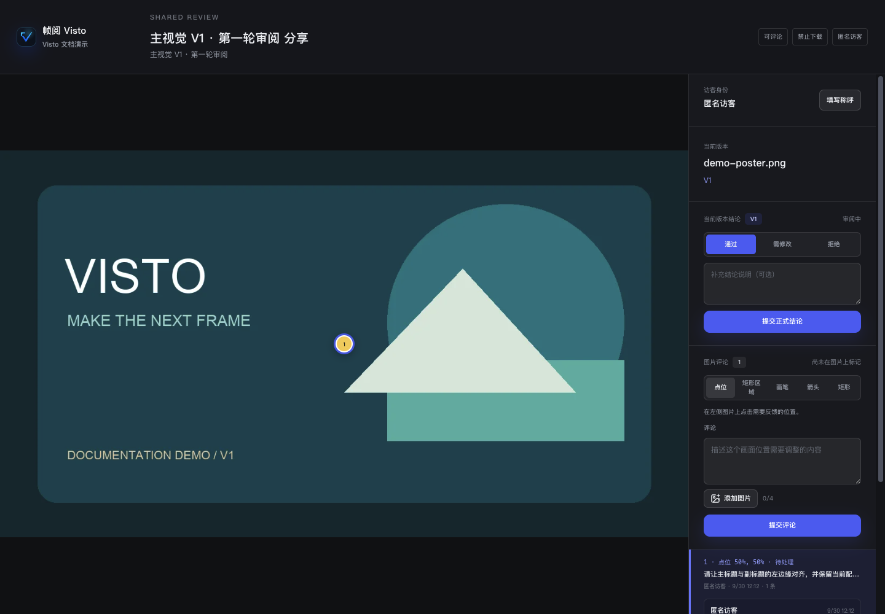

### 附件与回复

页面开放评论附件时，可附参考图片或文件。附件上传也可能经过安全检查；没有可用附件存储或策略拒绝时，先联系 Owner。涉及客户信息的参考文件只传到正确项目或分享。

回复里写清处理方案。具备权限的处理者可以把线程标为已解决；“已解决”表示反馈处理状态，不自动等于整轮审阅通过。

### 审核结论

具备结论权限的审阅者在审核结论区域提交：

| 结论 | 表达的意思 | 建议备注 |
| --- | --- | --- |
| 通过 | 当前审阅版本符合本轮要求 | 明确是否可以交付 |
| 需修改 | 需要进一步修订 | 指向未解决反馈或说明修改范围 |
| 拒绝 | 当前版本未达到要求 | 解释原因和下一步 |

按本轮通过条件汇总结论。分享开放评论且审阅未处于草稿或结束状态时，访客也可以对当前固定版本提交正式结论；匿名访客以分享会话记录身份。关闭分享评论权限时，访客的新评论与正式结论都不能提交。


<!-- chapter: sharing | 审阅与交付 -->
## 19 · 创建、安全检查与撤销分享

分享让外部人员访问指定审阅内容，不必给他们 Owner 账号或整个工作空间权限。

### 分享之前先检查四件事

1. **内容范围：** 只包含要让接收者看的媒体与版本。
2. **访问方式：** 按需要设置访问密码、到期时间及昵称要求。
3. **允许操作：** 评论与下载分别控制；能播放不代表允许下载原片。
4. **可达地址：** 接收者必须能访问该主机 / 团队域名；`127.0.0.1` 只能给本机用。

### 创建并验证

在创建审阅时设置访问策略，或在审阅详情的“分享与通知”创建分享。确认成功后复制链接，需要密码时将密码与链接妥善交付。

用另一个未登录的浏览器窗口验证：是否要求密码、显示的文件和版本是否正确、评论和下载是否如预期。再在接收者实际使用的网络设备上验证可达性；本机验证通过不能证明外网已能访问。

### 更新或撤销

在审阅详情的分享记录中查看现有分享、展开链接与密码，按页面支持调整策略、撤销或重新生成入口。撤销后再次从未登录窗口测试失效结果。

重新生成链接会影响原接收者，记得发送新链接。撤销只能阻止后续访问，无法收回已经下载或复制的内容。

### 为什么客户仍然看到旧版

分享引用的是对应审阅，而审阅固定了媒体版本。上传 V2 后，用 V2 创建新一轮并发送新入口。不要把“当前版本已更新”当成“所有旧链接都自动更新”。

**完成检查：** 未登录可按策略访问、链接实际可达、范围正确、密码和下载规则正确。


<!-- chapter: guest | 审阅与交付 -->
## 20 · 给外部审阅者的操作指南

本章可以直接交给客户或合作方。你通常只需要分享链接和发布方提供的访问码；无需安装 Visto，也不要索要团队 Owner 密码。

### 打开链接

1. 用浏览器打开收到的链接。
2. 页面要求密码时，输入发布方提供的访问码。
3. 要求昵称时，填写能让团队辨认的姓名或公司与姓名。
4. 检查显示的作品名称和版本，选择相应作品查看。

### 看画面、写反馈

图片可以用点位或区域评论标出问题；视频可以暂停后抓取当前时间，也可选择时间区间。建议格式：“位置 + 问题 + 希望的修改”。提交后确认评论出现在列表。

如页面只开放观看，评论按钮不会可用。下载同样由发布方决定，不能下载时先询问发布方是否需要交付源文件。

### 提交当前版本的正式结论

分享开放评论且审阅未结束时，可以在“当前版本结论”选择“通过”“需修改”或“拒绝”，填写说明后提交。确认页面显示已记录的结果。该操作针对当前固定版本；文字评论与正式结论是两种记录。分享关闭访客反馈或审阅结束后不能继续提交。

### 访问失败时

| 提示 / 现象 | 可以做什么 |
| --- | --- |
| 访问码错误 | 核对空格、大小写及是否收到新的密码 |
| 链接过期或撤销 | 请发布方确认分享记录并重新提供入口 |
| 页面打不开 | 确认是否需要加入团队网络 / VPN，是否是误发的本机地址 |
| 视频能打开但不能播放 | 告知发布方作品名、版本、浏览器和错误截图 |
| 没有评论或下载按钮 | 请发布方检查分享策略 |
| 看到旧版 | 发回所见版本号，请发布方确认新一轮分享 |

反馈问题时不要把访问密码、完整含令牌链接或客户原片发到公开社区。


<!-- chapter: notifications | 设置与维护 -->
## 21 · 通知、个人资料与活动

通知帮助成员及时看到审阅和协作变化。外部通知是否可用取决于 Owner 配置的渠道和成员自己的接收偏好。

### 我的账户

点击右上角个人入口，进入“我的账户”。查看身份、维护显示名称、界面语言和接收偏好，保存后确认成功提示。个人姓名会用于评论和成员列表；界面语言会影响导航与部分页面文案。

### 站内通知

从全局“通知”进入，查看自己有权访问的消息。点消息回到相关项目或审阅，阅读后按页面操作标记状态。没有消息时，先检查是否是正确账号和对应事件是否已发生。

### 外部渠道

Owner 在 **Owner 设置 → 全局通知** 配置邮件、飞书或企业微信等已有渠道，填写服务信息后测试。渠道密码、Webhook 和密钥只由 Owner 管理，不发送给普通成员。

“渠道测试成功”说明测试投递成功，不能单独证明每位成员都收得到：还要核对成员接收地址、个人偏好和真实事件投递状态。

### 活动与审计

项目设置中的活动记录帮助追踪谁在什么时候做过什么；Owner 系统活动用于全局排查。按时间、成员、动作和资源筛选，遇到失败投递时保留状态和错误信息再处理。活动记录不能代替媒体备份。


<!-- chapter: network | 设置与维护 -->
## 22 · 网络与远程访问

默认原生 Server 只监听本机；默认 Compose Web 也绑定本机。把分享链接交给异地客户以前，先由部署维护者配置可达地址和 HTTPS 入口。

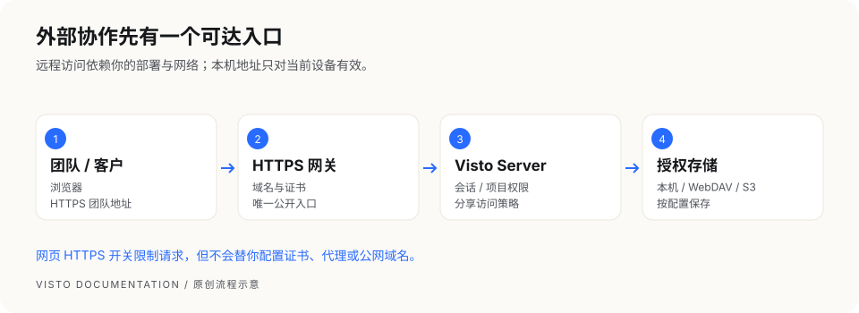

### 四个容易混淆的设置

| 设置 | 决定什么 | 不会替你完成什么 |
| --- | --- | --- |
| 服务监听 / 网关入口 | 哪些设备可以连接 | 不自动生成公网域名 |
| HTTPS 网关 | 对外链路加密和入口路由 | 不自动授予项目权限 |
| 远程访问必须使用 HTTPS | 拒绝非本机明文 API 请求 | 不负责安装证书或配置代理 |
| 网页端添加本机目录权限 | Owner 网页能否添加主机存储 | 不授予普通成员任意目录访问 |

### 正确的开启顺序

1. 维护者配置 HTTPS 域名、证书及反向代理，确保 Visto 正常工作。
2. 用远程设备访问 HTTPS 地址并验证登录和分享。
3. 在 **Owner 设置 → 网络与安全** 打开“远程访问必须使用 HTTPS”。
4. 保存后立即生效，再检查团队和分享入口。
5. 防火墙和代理应使 HTTPS 网关成为唯一公开入口。

该开关默认关闭。开启后，非回环明文 API 请求可能返回 `426 security.https_required`。本机 `127.0.0.1` 仍可使用 HTTP。正在通过远程 HTTP 操作时，系统会阻止会导致自锁的开启请求；请先切换到 HTTPS 或到部署主机操作。

### 由部署配置强制

`REVIEW_STUDIO_REQUIRE_HTTPS=1` 会强制 HTTPS 策略，网页不能关闭，需要维护者改主机配置并重启。代理信任和 Cookie 的安全标记由部署配置及真实请求协议决定，不能只打开网页开关就认为代理已正确配置。

### 推荐交付给成员的信息

团队的 HTTPS 地址、登录方式、项目邀请、能访问的网络范围及支持联系人。不要把主机配置、初始化令牌或底层存储密钥一并发送。


<!-- chapter: backup | 设置与维护 -->
## 23 · 备份：保护数据库与媒体

本章命令适用于 macOS 原生 Server，由部署维护者在主机执行。备份会短暂影响服务，选择没有上传和重要审阅的时间窗口。

### 先分清备份覆盖范围

| 数据 | 原生数据目录备份是否自动覆盖 | 应如何安排 |
| --- | --- | --- |
| 数据目录内的数据库、加密秘密、系统托管源文件和预览 | 随数据目录归档 | 保留归档与同名元数据 |
| 配在数据目录外的本机 / 外接盘媒体 | 不会因数据库记录存在就自动打包 | 单独复制或快照，并保持引用路径可用 |
| WebDAV / S3 上的实际媒体文件 | 不会自动下载全部对象到原生备份 | 使用对应存储的版本、快照或独立备份 |
| 主机配置、证书、部署说明 | 不应假定都在业务数据归档里 | 由维护者另做安全备份，妥善保护秘密 |

**最常见误区：** 数据库里有文件记录，不代表这份备份已经包含全部原片。先清点每个存储的物理落点，再决定备份范围。

### 创建备份

```bash
sudo /Library/Visto/current/scripts/backup-visto-server.sh
```

脚本会证明服务已经停止，再归档数据，随后按流程启动并检查就绪。停服证明失败时会中止；不要手动伪造成功记录或直接打包正在变化的数据库。

### 确认完成

1. 命令成功退出并打印实际备份路径。
2. 归档和 `<归档文件>.json` 元数据均存在。元数据记录摘要和恢复所需信息。
3. 服务重新就绪，浏览器能读取项目。
4. 把这两个文件一起复制到另一块磁盘或可信备份位置。
5. 把数据目录外媒体和部署配置的独立备份与此次备份关联记录。

### 建议的备份时机

首次完成配置后、重要交付后、每次更新前、每次恢复或大规模存储调整前。按项目价值安排日常周期，并定期在隔离环境检查可恢复性；“文件存在”不等于“恢复已验收”。


<!-- chapter: maintenance | 设置与维护 -->
## 24 · 更新、恢复、回滚与卸载

本章适用于 macOS 原生 Server。执行的是主机维护操作，普通项目成员无需运行。示例路径需要替换成实际文件位置；保留所有命令输出用于定位失败。

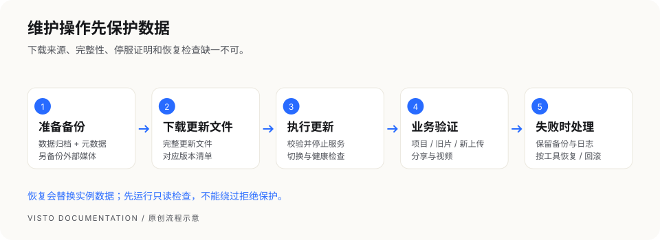

### 更新 Visto

**1.0.3 安装包尚未提供下列新版更新辅助脚本。这些更新命令用于后续新包；当前 1.0.3 实例更新时请使用对应 Release 的说明，不要直接执行不存在的脚本。**

网页提示新版本后，从官方发布入口下载完整更新文件：安装包、同名校验文件与版本清单，把三份文件放在一起。新版更新工具会读取配套文件并自动校验，你只需要指定安装包。它不会自动下载或自动更新。

旧版安装没有这个工具时，请使用原版本的更新说明。

1. 记录当前版本与运行状态。
2. 创建备份，把归档、元数据和外部媒体副本妥善保存。
3. 下载同一发布的包、摘要与版本清单。
4. 运行更新工具：

```bash
sudo /Library/Visto/current/scripts/update-from-package.sh \
  --package '/实际路径/Visto-Server_<版本>_macos-arm64.tar.gz'
```

脚本在校验、停服和备份保护后切换程序，检查健康状态；失败时按工具的恢复流程处理。不要手工改 `current` 链接。

### 更新后检查

```bash
curl -fsS http://127.0.0.1:8787/health/ready
sudo /Library/Visto/current/bin/visto-server --json \
  --address 127.0.0.1:8787 status
```

再用浏览器确认项目、旧文件、新上传、视频播放和分享。健康接口通过不能代替业务数据检查。

### 日常服务启停与日志

维护前确认没有在途上传或重要审阅。默认 macOS 实例可以用系统服务管理器停止或启动：

```bash
# 停止
sudo launchctl bootout system/com.visto.server
# 启动
sudo launchctl bootstrap system /Library/LaunchDaemons/com.visto.server.plist
# 已加载服务的重启
sudo launchctl kickstart -k system/com.visto.server
```

启动或重启后再次查 `health/ready` 并在网页验证。若提示服务不存在或已加载，先确认当前服务状态和实际安装配置，不反复执行。默认日志位于 `/Library/Logs/Visto`；保留相关时间段的错误即可，发给他人前脱敏。网页全局设置通常保存后立即生效，主机环境配置的修改则按要求重启。

### 恢复：先只读检查，再执行替换

恢复会替换**当前实例的数据目录**，会影响备份之后的业务变化。先保存当前实例的备份；确认目标主机、数据目录、归档和同名元数据。

```bash
sudo /Library/Visto/current/scripts/restore-visto-server.sh \
  --backup-file '/实际路径/备份.tar.gz' \
  --check-only
```

只读检查通过且你已确认覆盖影响后执行：

```bash
sudo /Library/Visto/current/scripts/restore-visto-server.sh \
  --backup-file '/实际路径/备份.tar.gz' \
  --confirm-restore
```

两种模式不能同时使用。当前恢复保护要求原数据目录一致；跨目录恢复可能被拒绝。拒绝时保留错误，不手工解压覆盖数据库，也不修改元数据去伪装路径。

恢复后确认服务就绪、项目和版本符合备份时间，原文件可读，外部存储仍可访问；数据目录外原片需要独立恢复与核对。

### 回滚到保留的程序版本

```bash
sudo /Library/Visto/current/scripts/rollback-visto-server.sh \
  --to-version '<已保留的版本>' \
  --confirm-rollback
```

程序回滚与数据恢复目的不同；不能假定旧程序一定兼容当前数据库。让工具执行对应保护，按具体失败说明处理。不要删除恢复点、备份或失败日志。

### 卸载

默认卸载保留用户数据和备份：

```bash
sudo /Library/Visto/current/scripts/uninstall-visto-server.sh --yes
```

如果提示 `could not be stopped`，卸载会中止并保留服务配置、程序和数据。先检查服务或进程，解决原因后再试，不手工删除服务配置。

卸载程序不会自动抹掉外接盘或远程存储上的文件。`--purge-data` 会扩大删除影响，只在确认不需要数据并有可用备份时按该版本说明使用。

### 删除视频组件（可选清理）

上面的卸载只处理服务注册和程序目录，**不会删除 FFmpeg 视频组件**。组件留在系统共享位置，重新安装时会直接复用、不重复下载，所以通常不必删除。只有在交还设备、彻底清理环境或确认不再安装 Visto 时才做这一步。

先完成卸载，并确认服务已注销：

```bash
launchctl print system/com.visto.server
```

输出 `Could not find service` 才继续。

| 平台 | 视频组件默认位置 | 卸载后 |
| --- | --- | --- |
| macOS | `/Library/Application Support/Visto/runtime` | 保留，需手工删除 |
| Linux | `/var/lib/visto-runtime` | 保留，需手工删除 |
| Windows | 程序目录 `runtime\ffmpeg` | 卸载时随程序一起移除 |

macOS：

```bash
sudo rm -rf "/Library/Application Support/Visto/runtime"
sudo ls -l "/Library/Application Support/Visto"
```

Linux：

```bash
sudo rm -rf /var/lib/visto-runtime
```

删除前核对三点：一、路径与上表一致，不要把 `data` 或 `backups` 目录写进删除命令；二、安装时若用环境变量 `VISTO_MEDIA_RUNTIME_ROOT` 指定过其它位置，改删该目录——实际值保存在卸载后仍然保留的配置里，可用 `sudo grep VISTO_MEDIA_RUNTIME_ROOT /Library/Visto/config/visto.env`（Linux 为 `/etc/visto/visto.env`）确认；三、本步不涉及业务数据与备份，是否保留它们由你另行决定。

删除后再安装时，安装器会重新下载并验签组件，这一步需要联网。


<a id="maintenance-macos"></a>
### macOS 主机维护

#### 4. 确认安装后的目录

| 内容 | 默认位置 | 日常用途 |
| --- | --- | --- |
| 程序与保留版本 | `/Library/Visto` | 使用 `current` 中的正式工具，不手工改链接 |
| 主机配置 | `/Library/Visto/config/visto.env` | 部署维护者修改，修改后按要求重启 |
| 业务数据 | `/Library/Application Support/Visto/data` | 包含数据库和系统托管数据，不能直接删除 |
| 默认备份 | `/Library/Application Support/Visto/backups` | 保存归档及其元数据，另做异盘副本 |
| 日志 | `/Library/Logs/Visto` | 故障定位，分享前脱敏 |
| 视频组件 | `/Library/Application Support/Visto/runtime` | FFmpeg 与 ffprobe；卸载后仍保留，重装会复用 |

**完成检查：** 服务就绪、浏览器能打开向导、未忽略安装失败信息。视频预览还需要下一章的媒体运行时。


<a id="maintenance-windows"></a>
### Windows 主机维护

#### 5. 程序、配置、数据分别在哪里

| 内容 | 默认位置或入口 | 用途 |
| --- | --- | --- |
| 程序与网页 | `C:\Program Files\Visto Server`（示例） | 固定程序目录，更新由脚本替换 |
| 配置 | 程序目录下 `visto-server.json` | 监听地址、数据目录及部署选项 |
| 实例数据 | `%ProgramData%\Visto\data` | 数据库、秘密、数据目录内上传及预览 |
| 默认备份 | `%ProgramData%\Visto\backups` | 数据归档和同名元数据 |
| 启停 | 计划任务 `Visto Server` | 默认开机自启、使用 SYSTEM |
| 当前视频依赖 | 程序目录 `runtime\ffmpeg` | 当前包内运行时；以后以包说明为准 |

修改配置前保留受保护的原配置副本，修改后重启任务。配置与令牌包含敏感信息，不作为公开求助附件。

#### 6. 日常启动、停止和诊断

```powershell
Stop-ScheduledTask -TaskName 'Visto Server'
Start-ScheduledTask -TaskName 'Visto Server'
.\bin\visto-server.exe --data-dir "$env:ProgramData\Visto\data" doctor
.\bin\visto-server.exe --data-dir "$env:ProgramData\Visto\data" diagnostics export `
  --output "$env:USERPROFILE\Desktop\visto-diagnostics.zip"
```

停止命令发出后需确认任务和相关进程确实停止。备份、恢复和更新脚本会进行自己的停服确认，不要删掉检查来强制执行。如果文件锁导致备份失败，任务可能保持停止；解除占用后先检查备份结果，再显式启动任务并验证健康和媒体，不假定自动恢复。诊断包先自行检查敏感内容，再按受控方式交给维护者。

#### 7. 备份与恢复

先通知成员暂停写入，再运行：

```powershell
.\Backup-VistoServer.ps1 -BackupDirectory 'D:\Visto-backups'
```

成功结果必须同时有 ZIP 与同名 `.zip.json` 元数据，保留二者并复制到独立位置。该备份覆盖实例数据目录；配置在程序目录、外部本机媒体目录、WebDAV 和 S3 原片需另行保护。不能把一个 ZIP 当成全部项目原片的备份。

恢复分为两步。以下文件名为示例，替换为真实备份：

```powershell
.\Restore-VistoServer.ps1 -BackupFile 'D:\Visto-backups\visto-server-data-20260930-120000.zip' -CheckOnly
.\Restore-VistoServer.ps1 -BackupFile 'D:\Visto-backups\visto-server-data-20260930-120000.zip' -ConfirmRestore
```

只读检查通过后，先确认当前数据也有独立备份，再执行替换。不要同时传 `-CheckOnly` 与 `-ConfirmRestore`。摘要、归档路径或来源数据目录不符时停止；不编辑元数据骗过检查，也不用恢复命令做跨目录迁移。恢复后检查项目、旧媒体、新上传与分享。

#### 8. 更新与失败恢复

从 1.0.3 更新到 1.0.4 时，先下载同次发布的 ZIP、同名 `.sha256` 和 `.manifest.json`，核对发布摘要，并将 ZIP 解压到独立临时目录。旧更新器不认识新增维护文件；使用新包中的入口，明确指定已有安装目录。以管理员身份打开 PowerShell，将示例路径换成实际位置：

```powershell
& 'D:\Downloads\Visto-Server_1.0.4\Update-VistoServerPackage.ps1' `
  -PackageArchive 'D:\Downloads\Visto-Server_1.0.4_windows-x64.zip' `
  -InstallDirectory 'C:\Program Files\Visto Server' `
  -BackupDirectory 'D:\Visto-backups'
```

该入口使用已有实例的校验器和更新保护，保留配置、令牌、数据及视频组件。不要把新文件手工覆盖进运行目录，也不要重新执行首装入口。

新版更新工具会读取安装包旁的同名校验文件和 `.manifest.json`。请下载完整更新文件；缺少配套文件时联系发布方，不自行编写清单。

更新只接受完整交付 ZIP，包括固定视频二进制、许可证、构建记录和视频审计材料；不要裁剪文件或向运行时目录随意添加 DLL。

脚本校验并暂存输入，备份数据、停止任务、替换程序并等待恢复。失败时会尝试还原旧程序及更新前数据。即使脚本报告成功，也要核对健康接口与实际业务；端口能连不代表媒体和数据库已正常。当前 Windows 脚本没有独立的 `Rollback-VistoServer.ps1`，不要照搬 Unix 回滚命令。自动恢复失败时保留原程序、备份与错误输出，交给维护者处理。

#### 9. 常见问题按现象处理

| 现象 | 先检查 | 下一步 |
| --- | --- | --- |
| 提示需要管理员权限 | PowerShell 是否“以管理员身份运行” | 重新打开管理员窗口，进入程序目录 |
| 脚本被系统拦截 | 文件来源、摘要与组织策略 | 按安全软件/管理员提示处理，不全局关闭保护 |
| 缺少 FFmpeg、网页或安全模块 | 是否解压完整、是否拿错包 | 重取同版本完整包，保留错误信息 |
| 任务存在但页面打不开 | 任务结果、健康接口、配置端口 | 执行 doctor；不要把任务存在当成功 |
| 端口被占用 | `Get-NetTCPConnection -LocalPort 8787 -ErrorAction SilentlyContinue` | 安装会先拒绝占用，尚不创建新数据或任务；找到占用程序后决定是否改配置，不盲目结束进程 |
| 服务读不到映射盘 | SYSTEM 与登录用户的访问差异 | 用受维护存储连接或明确服务可访问的存储方案 |
| 更新提示文件锁或停服失败 | 是否还有服务/媒体进程 | 保留现场，解决占用后再试，不手工覆盖 |
| ACL 或重解析点检查失败 | 目录权限、联接/符号链接 | 修复受信目录布局，不删保护检查 |

#### 10. 卸载与交付检查

```powershell
.\Uninstall-VistoServer.ps1
```

默认停止并删除开机任务，保留实例数据；不等于程序目录和外部原片已删除。只有独立备份可读、确定永久清除实例数据后，才使用 `-RemoveData`。不要将清除命令当成排障方法。

交付前逐项确认：重启电脑后服务就绪；Owner 可登录；成员仅看授权项目；旧媒体能打开；新上传能生成预览；HTTPS 分享可访问；备份 ZIP 与元数据已独立保存。当前候选已在干净 Windows 11 客体执行安装、浏览器播放、更新回退、恢复、整机重启及卸载保留检查。文件锁失败仍须按上面的人工处置步骤处理；有 NVIDIA 显卡不代表此组件支持 NVENC。


<a id="maintenance-linux"></a>
### Linux 主机维护

#### 5. 安装后的目录地图

| 内容 | 默认位置 | 维护方式 |
| --- | --- | --- |
| 程序版本 | `/opt/visto/releases/<版本>` | 各版本独立保存 |
| 当前程序 | `/opt/visto/current` | 指向当前版本，不手动替换 |
| 配置 | `/etc/visto/visto.env` | 系统管理员维护，包含秘密 |
| 数据 | `/var/lib/visto` | 数据库、秘密、目录内上传与预览 |
| 备份 | `/var/backups/visto` | 归档与同名元数据 |
| 日志 | systemd 239 使用 journal；240 及以上使用 `/var/log/visto/server.log`、`server.err` | 排查启动与处理错误 |
| 服务定义 | `/etc/systemd/system/visto.service` | 安装器生成 |
| 媒体运行时根 | `/var/lib/visto-runtime` | 使用当前版本支持的运行时工具管理 |

如果安装时使用自定义数据目录或部署覆盖变量，记录真实路径，维护命令也要匹配该实例，不能假定所有主机都用默认值。外部媒体根权限与服务沙箱需要一致；系统管理员应按实际存储方案配置，不通过关闭全部服务保护来解决读写问题。

#### 7. 启停、日志和诊断

```bash
sudo systemctl stop visto.service
sudo systemctl start visto.service
sudo systemctl restart visto.service
sudo journalctl -u visto.service -n 100 --no-pager
sudo tail -n 100 /var/log/visto/server.err
sudo /opt/visto/current/bin/visto-server --data-dir /var/lib/visto doctor
```

systemd 239 使用 `sudo journalctl -u visto.service -n 100 --no-pager` 查看日志，文件日志步骤只用于 systemd 240 及以上。

服务启动失败时先读日志，再检查配置和依赖；不要反复重装或删除数据。日志可能含路径和用户信息，提供求助材料前脱敏。服务修改配置后需重启；网页中的业务设置按页面反馈判断保存是否完成。

#### 8. 备份并验证覆盖范围

```bash
sudo /opt/visto/current/scripts/backup-visto-server.sh
```

也可在独立备份磁盘上指定保存目录，须确认磁盘已挂载且容量足够：

```bash
sudo /opt/visto/current/scripts/backup-visto-server.sh --backup-dir /mnt/backup/visto
```

脚本先证明服务停止，再归档数据目录并生成数据库事实元数据，之后启动服务。只有归档和元数据均成功生成才算备份完成。备份放另一磁盘或可信远程位置；外部媒体、WebDAV、S3、`/etc/visto` 的部署配置另行备份。迁移到新主机还涉及恢复路径约束，不能直接承诺跨主机/跨目录恢复。

#### 9. 更新、恢复与回滚

**更新**使用实际下载的包、摘要和同版本清单。示例输入需全部替换：

```bash
sudo /opt/visto/current/scripts/update-from-package.sh \
  --package '/实际路径/Visto-Server_1.0.3_linux-amd64.tar.gz'
```

上面示例为 x86_64；ARM64 使用同版本的 `Visto-Server_1.0.3_linux-arm64.tar.gz` 和该文件对应摘要，不能混用架构。

脚本验证布局，准备新版本、备份数据、停服并切换 `current`，失败时尝试还原。没有清单时停止，不手工改 `current` 或覆盖运行中的程序。更新成功后检查旧数据与新上传，不只看进程。

**恢复**先跑只读检查；示例归档名替换为真实备份：

```bash
sudo /opt/visto/current/scripts/restore-visto-server.sh \
  --backup-file '/var/backups/visto/实际备份.tar.gz' --check-only
sudo /opt/visto/current/scripts/restore-visto-server.sh \
  --backup-file '/var/backups/visto/实际备份.tar.gz' --confirm-restore
```

恢复会替换当前实例数据，先另做当前数据备份。归档与同名元数据必须一起保留，只支持检查认可的原数据目录；旧格式元数据或路径不符被拒绝时，不手改元数据。

**回滚程序版本**先检查保留的版本：

```bash
sudo ls /opt/visto/releases
sudo /opt/visto/current/scripts/rollback-visto-server.sh \
  --to-version '<仍保留的版本号>' --confirm-rollback
```

回滚程序不等于把数据库和媒体恢复到任意历史时刻。数据兼容性与恢复需求要分别判断；目标版本已清理或数据不兼容时联系维护者。成功后重新检查健康、登录、媒体与分享。

#### 10. 网络与常见问题

默认 Core 仅监听回环。日常远程访问用受维护的 HTTPS 反向代理，再在工作空间配置外部访问地址；不要直接把 8787 暴露到公网。防火墙开放的是代理入口，浏览器里的本机地址不能发给客户。

| 现象 | 先检查 | 处理方向 |
| --- | --- | --- |
| `Exec format error` | `uname -m` 与安装包架构 | 换同架构完整包 |
| glibc 版本错误 | `getconf GNU_LIBC_VERSION` | 换受支持系统，不替换系统 C 库 |
| 找不到 systemctl | 主机是否真正使用 systemd | 选择符合基线主机，或按 Docker 支持范围部署 |
| 安装缺网页/脚本/声明 | 解压根目录与包完整性 | 用完整包，不分别下载文件拼装 |
| 服务启动失败 | `journalctl`、`server.err` | 查地址占用、配置、目录权限与运行依赖 |
| 端口被占用 | `sudo ss -ltnp 'sport = :8787'` | 查明占用者，选择其它端口，不盲目杀进程 |
| 上传不能写或空间不足 | 实际存储权限、挂载和 `df -h` | 修复真实存储条件，保留已有数据 |
| 视频无预览 | 同架构运行时、处理任务状态 | 核对运行时供应和安装结果 |
| SSH 转发打不开 | SSH 连接、远端健康、本机端口 | 分别确认两端，不改为公网裸端口 |
| 停服检查/恢复预检被拒绝 | 相关子进程、元数据与来源目录 | 保留现场，解决原因后再试，不绕过保护 |

#### 11. 卸载与最终检查

```bash
sudo bash /opt/visto/current/scripts/uninstall-visto-server.sh
```

默认停止并注销服务、移除程序发布目录，保留用户数据、备份和日志。停服失败会中止卸载，保留服务配置和程序；看到 `could not be stopped` 时先检查服务或进程，解决原因后再试，不手工删除服务配置。卸载前另存配置和完整备份；`--keep-releases` 可保留程序版本。`--purge-data` 会额外删除数据和备份目录，只有明确永久清除并确认独立备份可恢复时才使用，不能当排障步骤。

视频组件不在卸载范围内：默认位于 `/var/lib/visto-runtime`，卸载后仍保留。需要彻底清理时看[更新、恢复、回滚与卸载](maintenance.html)里的“删除视频组件”一节，不要连同数据目录一起删。

交付清单：安装架构正确；整机重启后健康成功；首次设置与权限正确；图片与视频预览通过；真实存储可读写；外部 HTTPS 分享可达；备份归档与元数据已独立保存；更新和恢复在对应平台受控验证。当前候选已在 x86_64 Rocky 8.10 与 ARM64 Ubuntu 24.04 客体执行安装、媒体、恢复及整机重启检查；ARM64 Rocky 8.10 的兼容补验在完整模拟客体执行。模拟客体结果不代表真实 ARM64 服务器硬件通过。


<!-- chapter: troubleshooting | 帮助与参考 -->
## 25 · 按现象排查问题

先记录“发生了什么、在哪个版本和页面、最近改变了什么”，再做最小检查。失败时不要删除数据或绕过权限、哈希、路径和恢复保护。

### 页面打不开

确认浏览器地址是否是这台主机的地址。原生 macOS 默认本机 8787，Docker 默认本机 8080；实际端口以部署配置为准。

```bash
curl -i http://127.0.0.1:8787/health/ready
```

- 连接被拒绝：检查服务是否运行、端口和 Gatekeeper。
- 返回未就绪：保留响应，查看服务日志与数据库 / 运行时状态。
- 本机能访问而远程失败：检查监听、HTTPS 网关、网络和防火墙。
- `426`：使用正确 HTTPS 入口，核对强制 HTTPS 策略。

### 无法创建项目或上传

| 检查项 | 如何判断 |
| --- | --- |
| 当前账号 / 项目 | 确认处于正确工作空间和项目 |
| 具体权限 | 让项目主管检查上传或管理权限 |
| 存储开放 | Owner 已将活动上传位置开放给这个项目 |
| 空间、配额和写入权限 | Owner 看存储状态，维护者检查磁盘和服务账号 |
| 归档状态 | 已归档项目需要先恢复为进行中 |
| 文件与网络 | 先用小测试文件检查，保留原失败信息 |

### 上传完成但视频没有预览

确认媒体安全检查、后台队列、失败任务和 FFmpeg / ffprobe 状态。部分增强失败可能只影响时间轴缩略图等功能，按页面说明判断，不一概把素材记为完全不可用。

```bash
curl -fsS http://127.0.0.1:8787/health/ready
```

程序检测正常后，再看具体任务错误、文件格式和磁盘空间。文件损坏、来源不可读与运行时未安装需要不同处理。

### 文件被隔离或拒绝

Owner 到 **存储与上传安全 → 隔离与异常** 查看文件、检查结果和原因。“刷新状态”用于重新读取现有结果，不代表强制重做安全扫描。只有确认原因和风险后，才使用页面允许的放行或拒绝操作。普通成员不能绕过隔离去分享或下载。

### 原片曾能打开，现在提示不可读

检查外接盘是否挂载、NAS / S3 是否在线、连接权限是否改变、本机文件是否被移走或删除。不要立即重新导入全部文件。项目回收站恢复的是项目关系，底层媒体丢失仍需从实际媒体备份恢复。

### 分享打不开、过期或没有按钮

先核对当前分享是否被撤销、密码和有效期、审阅状态及链接地址。没有评论或下载按钮，检查对应访问策略；接收者打不开本机地址时，需要正确团队网络入口。

### 保存冲突、登录失效

设置被其他会话修改时，重新载入最新值后再提交，避免覆盖别人的改动。登录失效时重新登录并确认角色；不要用 Owner 账号替代所有成员操作。

### 更新或恢复失败

保留当前数据、安装包、版本清单、摘要、备份、元数据和输出。先解决缺失文件、错误版本或路径不一致。停服证明、哈希或恢复检查不通过时，停止后续写入，联系维护者。


<!-- chapter: faq | 帮助与参考 -->
## 26 · 常见问题

### 我需要安装 Desktop 才能用吗？

本手册的免费 Server 浏览器工作流不以 Desktop 为前置依赖。团队已经部署 Server 时，你只需要地址、账号或分享入口。

### 数据会自动上传到云端吗？

媒体按 Owner 配置的保存位置存储。本机部署和远程存储是不同选择；启用 WebDAV / S3、外部通知或远程分享时，相应数据会经过所配置服务与网络。

### 同一个文件名会自动合并成版本吗？

不要依赖文件名相同自动合并。需要修订原作品时，打开原资产并使用“上传新版本”，再核对版本历史。

### 上传新版后，旧分享会显示新版吗？

不要这样假定。审阅引用固定版本；用新版创建下一轮审阅并发送正确入口，旧审阅继续保留旧版本的上下文。

### 注册后为什么看不到项目？

账号存在不代表已加入项目。请 Owner 或项目主管添加项目成员关系并核对状态、期限和权限。

### 为什么网页不能再改本机目录权限？

这个开关只在首次设置时询问一次。后续由主机配置修改并重启，避免 Owner 网页会话自行改变主机访问边界。

### 归档后文件已经复制到归档盘了吗？

没有这个保证。项目归档是生命周期操作，物理存储复制和备份是独立操作，必须分别确认完成结果。

### 拷贝数据库就算备份全部媒体吗？

不算。需要一致性数据库和加密秘密，也要清点系统托管媒体、外部目录及远程文件。参见“备份”。

### 安全扫描没有结果，是不是安全？

“未扫描”“等待”或“引擎不可用”不能等同安全通过。结合策略、实际引擎和检查结果处理。

### 网页显示有更新会自动安装吗？

免费 Server 只提示版本，主机维护者手动从官方发布页下载校验并更新。媒体运行时的签名安装流程另行处理。

### 能把本机分享地址发给客户吗？

`127.0.0.1` 只对当前设备有效。客户需要一个可达的团队地址和符合策略的 HTTPS 入口。

### 可以在手机上使用吗？

手机使用范围见对应版本的支持说明。上传大文件和精细画面标记建议使用电脑；文档可以在手机浏览器阅读。


<!-- chapter: checklist | 帮助与参考 -->
## 27 · 交付检查单与求助模板

### 项目主管：每轮审阅前

- 选定的资产、版本和审阅目标一致。
- 参与者、负责人和通过条件符合本轮要求。
- 截止时间与访问有效期符合安排。
- 分享密码、评论、下载范围已核对。
- 从未登录窗口和接收者网络验证入口。

### 项目成员：提交新版本后

- 上传成功且处理状态可用。
- 新版出现在原资产历史中，当前版本正确。
- 修订说明包含处理的反馈范围。
- 下一轮审阅引用新版，不误发旧链接。

### 维护者：部署或更新后

- 服务就绪，媒体运行时可用。
- 使用正确账号读回既有项目与旧文件。
- 小文件上传、图片预览、视频播放和外部分享可用。
- 备份归档、元数据、外部媒体与主机配置备份齐全。
- 重启后的数据与服务仍可读，或明确记录未测。

### 报告问题时提供什么

复制下面模板给团队维护者；公开问题只发脱敏内容。安全问题通过项目的安全报告入口私下提交。

```text
问题标题：
Visto 版本 / 部署方式：
系统 / 浏览器版本：
发生时间与时区：
我的身份（Owner / 项目主管 / 成员 / 分享访客）：
所在页面与操作：
复现步骤：
1.
2.
3.
预期结果：
实际结果与错误提示：
影响范围（单文件 / 单项目 / 所有用户）：
最近是否更新、改存储或改网络：
已经做过的检查：
脱敏截图或日志片段：
```

不要公开发送原数据库、客户原片、存储密码、初始化令牌、私钥或完整带访问令牌的分享链接。截图也要检查浏览器地址、账号、主机路径和客户信息。

### 文档与界面不同怎么办

截图使用演示工作空间，界面名称和位置可能随版本调整。先确认自己使用的 Visto 版本；仍找不到入口时，把页面截图和要完成的操作交给团队维护者。
